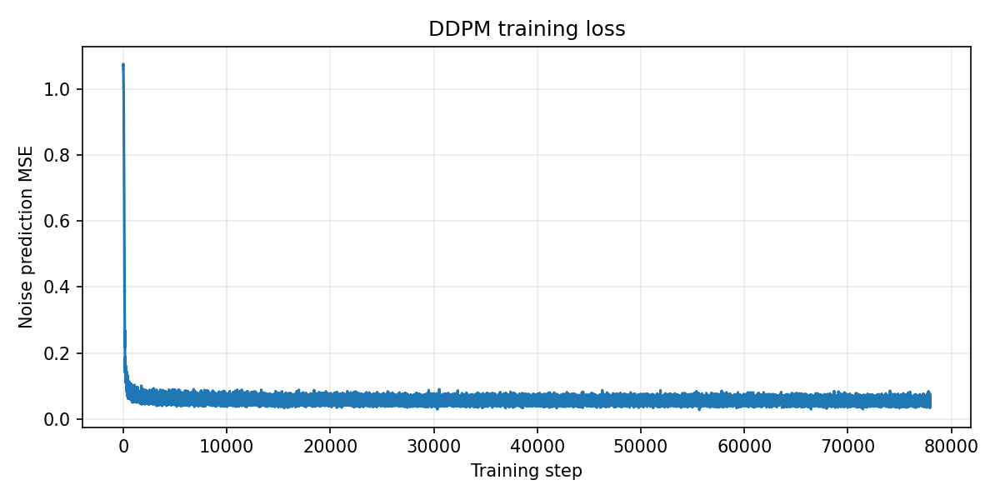
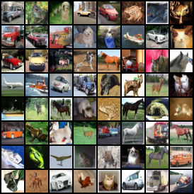

# Project 1：From-Scratch DDPM 实验报告

本文件整合了 project1_ddpm 基础档、进阶档、挑战档、
FID 改进、学习率筛选、采样诊断和复现说明。

## 一、全部实验结果总览

| 实验条件 | 数据与预算 | 主要设置 | EMA FID（0.999 / 0.9995 / 0.9999） | Raw / 其他指标 | 结论 |
|---|---|---|---:|---:|---|
| MNIST 基础档 | MNIST，50 epoch，23,400 steps | linear beta，$`\epsilon`$ prediction | — | FID 32.8913；末次 loss 0.01151；24.8 min | 基础实现、训练、采样完成 |
| CIFAR-10 进阶基线 | CIFAR-10，200 epoch，78,000 steps | linear beta，$`\epsilon`$ MSE，EMA | — / — / 19.2879 | raw 28.7464；98.2 min | 进阶档完成，未达 $`\mathrm{FID}\le 15`$ |
| 挑战 linear，seed 42 | CIFAR-10，200 epoch | linear beta，基础 U-Net | — / — / 19.2879 | raw 28.7464 | 稳定优于同期 cosine |
| 挑战 linear，seed 43 | CIFAR-10，200 epoch | linear beta，基础 U-Net | — / — / 19.6306 | raw 42.7537 | seed 方差可见 |
| 挑战 linear，seed 44 | CIFAR-10，200 epoch | linear beta，基础 U-Net | — / — / 18.9593 | raw 34.9399 | 初始挑战矩阵中的最好 linear |
| 挑战 linear 汇总 | 3 seeds，200 epoch | linear beta | — / — / 19.2926 ± 0.3357 | raw 35.4800 ± 7.0193 | 初始挑战主线 |
| 挑战 cosine，seed 42 | CIFAR-10，200 epoch | cosine beta，基础 U-Net | — / — / 137.9856 | raw 283.4196 | 未裁剪端点异常明显 |
| 挑战 cosine，seed 43 | CIFAR-10，200 epoch | cosine beta，基础 U-Net | — / — / 129.2708 | raw 399.1676 | 失败案例 |
| 挑战 cosine，seed 44 | CIFAR-10，200 epoch | cosine beta，基础 U-Net | — / — / 145.2832 | raw 410.0121 | 失败案例 |
| 挑战 cosine 汇总 | 3 seeds，200 epoch | cosine beta | — / — / 137.5132 ± 8.0166 | raw 364.1998 ± 70.1675 | 初始 cosine 采样异常 |
| 改版R1 full linear default | 200 epoch，seed 44 | 完整 U-Net，linear，固定 LR | 18.9792 / 18.5210 / 18.8144 | 未裁剪 18.8045 | 完整 U-Net 基线 |
| 改版R2 full linear cosine-LR | 200 epoch，seed 44 | 完整 U-Net，linear，LR 尾段衰减 | 20.3343 / 20.1602 / 19.4633 | 未裁剪 19.4615 | LR 尾衰减在 linear 上未改善 |
| 改版R3 full cosine default | 200 epoch，seed 44 | 完整 U-Net，cosine，固定 LR | 15.7886 / 15.5340 / 16.1686 | raw 66.6401；未裁剪 162.8797 | 裁剪后大幅恢复，最佳 15.5340 |
| 改版R4 Min-SNR | 200 epoch，seed 44 | cosine + Min-SNR $`\gamma=5`$，无 late decay | 16.3013 / 15.7954 / 16.5633 | raw 29.1437 | 不如 R5 |
| 改版R5 late decay | 200 epoch，seed 44 | cosine + uniform $`\epsilon`$ MSE + LR late decay | 16.3823 / 16.2361 / 15.4385 | raw 16.1927 | **当前正式最佳，但仍高 0.4385** |
| 改版R6 Min-SNR late decay | 200 epoch，seed 44 | R5 + Min-SNR $`\gamma=5`$ | 17.2559 / 16.9445 / 15.8562 | raw 17.8510 | Min-SNR 在本配置下退化 |
| 改版R7 v-prediction | 200 epoch，seed 44 | R5 设置，$`\epsilon\to v`$ target | 19.0443 / 18.8484 / 17.4808 | raw 19.2896 | 单独切换 v-prediction 无效 |
| 调整学习率LR=5e-5 | 200 epoch，seed 44 | cosine，peak 5e-5，late decay | 17.4472 / 17.3407 / 16.5231 | raw 18.6642 | 30 epoch 最优候选未延续 |
| 调整学习率LR=2.5e-4 | 50 → 200 epoch，seed 44 | cosine，peak 2.5e-4，late decay | 16.0761 / 15.8897 / 15.6761 | raw 16.8996 | 不如 R5 的 0.9999 |
| **R5 seed 测试** | 同一 R5 checkpoint | seed 44/45/46，5,000/5,000 | EMA 0.9999条件下，各seed对应**15.4385 / 15.4678 / 15.2086** | 均值 15.3717 | **R5在以上测试中效果最佳，FID最可能接近15** |

当前实现的最佳值为seed=46下的 **R5 EMA 0.9999 = 15.2086**。

## 二、实现内容

- schedule.py：linear/cosine beta schedule、$`\alpha`$、累积 $`\bar{\alpha}`$、posterior
  mean 系数和 posterior variance；
- diffusion.py：闭合形式前向加噪 q_sample、$`\epsilon`$/$`v`$ 训练损失、单步反向采样
  p_sample、完整 p_sample_loop；
- model/embedding.py：sinusoidal timestep embedding；
- model/unet.py：带时间条件的 ResBlock、下采样/上采样和 skip connection，
  并在 16×16 分辨率使用 attention；
- dataset.py：MNIST/CIFAR-10 数据加载，统一归一化到 [-1, 1]；
- train.py：AdamW、warmup、EMA、AMP、梯度裁剪、checkpoint 和 loss history；
- sample.py：按指定 EMA/raw 权重生成样本网格；
- evaluate.py：固定真实数据 split、样本数、seed，支持多 EMA 对照；
- challenge.py：linear/cosine × 多 seed 的挑战档编排和汇总；
- monitor.py、experiment_monitor.py、challenge_monitor.py：只读训练进度监控；
- tests/：schedule、diffusion 和模型的静态测试源码。

前向过程的核心公式为：

```math
\begin{aligned}
x_t &= \sqrt{\bar{\alpha}_t}\,x_0\quad+ \sqrt{1 - \bar{\alpha}_t}\,\epsilon
\end{aligned}
```

训练时随机采样 $`t`$，直接由闭合形式得到 $`x_t`$，模型预测噪声 $`\epsilon_\theta(x_t,t)`$，
默认目标为：

```math
\mathcal{L}_{\mathrm{simple}} = \mathrm{mean}\!\left[\left(\epsilon - \epsilon_\theta(x_t,t)\right)^2\right]
```

反向采样从标准高斯噪声开始，按 $`T-1`$ 到 $`0`$ 逐步计算 posterior mean；$`t=0`$ 不再加入随机噪声。

## 三、评估协议

### CIFAR-10 FID

使用固定的 CIFAR-10 train split 前 5,000 张真实图像，关闭随机增强，
每次生成 5,000 张图，生成 seed 为 44。模型分别评估 EMA 0.999、0.9995、0.9999
和 raw；R3–R7 的主结果使用 clip_denoised=True，即在每个反向步骤将预测的 $`\hat{x}_0`$
裁剪到 [-1, 1]。

此评估方法让不同训练方案在尽量相同真实子集、生成 seed、样本数和采样处理下进行单变量比较。


## 四、基础档与进阶档

### 4.1 MNIST 基础档

MNIST 基线使用 linear schedule、50 epoch、23,400 steps，最后记录 loss 为 0.01151，使用 EMA 生成 5,000 张样本的FID 为 32.8913。该结果的主要意义是验证从加噪、时间嵌入、ResBlock 注入到反向
采样的完整链路。

### 4.2 CIFAR-10 进阶档

进阶基线使用 CIFAR-10、200 epoch、78,000 steps、linear beta 和 $`\epsilon`$ MSE，维护
raw 与 EMA 权重。最终 loss 为 0.01938，训练约 98.2 分钟：

- EMA FID：19.2879；
- raw FID：28.7464；
  
因此 EMA 对采样质量有明显帮助，但这个单次结果距离 $`\mathrm{FID}\le 15`$ 仍有 4.2879。

## 五、挑战档：linear 与 cosine

挑战档在相同模型、200 epoch、CIFAR-10 和 5,000/5,000 FID 协议下比较两个
schedule，并使用 seed 42、43、44：

| Schedule | Seed 42 | Seed 43 | Seed 44 | 均值 ± 标准差 |
|---|---:|---:|---:|---:|
| linear EMA | 19.2879 | 19.6306 | 18.9593 | 19.2926 ± 0.3357 |
| cosine EMA | 137.9856 | 129.2708 | 145.2832 | 137.5132 ± 8.0166 |
| linear raw | 28.7464 | 42.7537 | 34.9399 | 35.4800 ± 7.0193 |
| cosine raw | 283.4196 | 399.1676 | 410.0121 | 364.1998 ± 70.1675 |

初看结果会得出“linear 明显优于 cosine”的结论，但这只适用于初始矩阵的模型和采样实现。后续发现 cosine schedule 在 **末端极小的 $`\bar{\alpha}_t`$ 下会产生巨大的 $`\hat{x}_0`$** 反推值；在完整 U-Net、明确的 clipping 和诊断加入后，cosine 可以达到约 15–16的 FID。因此 schedule 不能脱离网络、loss、采样处理和训练预算单独评价。

## 六、改进实验

### 6.1 R1/R2/R3：完整 U-Net、linear schedule 与固定学习率

三组均严格保持 200 epoch、约 78,000 steps、seed 44 和固定正式 FID 协议：

| 实验 | 变化 | EMA 0.999 | EMA 0.9995 | EMA 0.9999 | 其他 |
|---|---|---:|---:|---:|---|
| R1 | 完整 U-Net + linear beta + warmup 后固定 LR | 18.9792 | 18.5210 | 18.8144 | 未裁剪 0.9999：18.8045 |
| R2 | R1 + linear beta + cosine LR 尾段 | 20.3343 | 20.1602 | 19.4633 | 未裁剪 0.9999：19.4615 |
| R3 | 完整 U-Net + cosine beta + warmup 后固定 LR | 15.7886 | **15.5340** | 16.1686 | 未裁剪 0.9999：162.8797 |

R3 的 EMA decay 直接说明 EMA 不是越大越好，本 checkpoint 上 0.9995 优于 0.9999。

### 6.4 R4/R5/R6：Min-SNR 与后期学习率衰减

R4、R5、R6 都使用完整 U-Net、cosine beta、200 epoch、batch 128、seed 44、warmup、
EMA 对照和裁剪 $`x_0`$：

| 实验 | 训练目标/学习率策略 | EMA 0.999 | EMA 0.9995 | EMA 0.9999 | raw |
|---|---|---:|---:|---:|---:|
| R4 | Min-SNR $`\gamma=5`$，无 late decay | 16.3013 | **15.7954** | 16.5633 | 29.1437 |
| R5 | uniform $`\epsilon`$ MSE，late decay $`2\times10^{-4}\to2\times10^{-5}`$ | 16.3823 | 16.2361 | **15.4385** | 16.1927 |
| R6 | Min-SNR $`\gamma=5`$ + late decay | 17.2559 | 16.9445 | **15.8562** | 17.8510 |

R5 比 R4 的最佳值改善 0.3569，说明在当前配置下后期学习率衰减有效；R6 比 R5 高 0.4177，说明直接使用 Min-SNR $`\gamma=5`$ 没有解决当前问题。

### 6.5 R7：v-prediction

R7 保持 R5 的 U-Net、cosine beta、200 epoch、78,000 steps、warmup、late decay、
seed 和 clipping，只把 $`\epsilon`$ prediction 改为 $`v`$-prediction：

| 权重 | FID |
|---|---:|
| EMA 0.9990 | 19.0443 |
| EMA 0.9995 | 18.8484 |
| EMA 0.9999 | **17.4808** |
| raw | 19.2896 |

R7 最佳值比 R5 高 2.0423，说明当前 uniform v-loss 与 timestep 分布、cosine
schedule 和采样方式组合不适合直接替代 R5；如果以后再研究 v-prediction，必须同时设计与 target 匹配的 loss weighting。

## 七、学习率实验

### 7.1 30 epoch 粗筛

7 组实验使用完整 U-Net、cosine beta、$`\epsilon`$ prediction、seed 44、batch 128、
1,000 steps warmup 和 1,000/1,000 快速 FID：

| 学习率 | 最终 loss | 快速 FID | 判断 |
|---:|---:|---:|---|
| 5e-5 | 0.05284 | **238.0244** | 快速筛选最优 |
| 8e-5 | 0.05245 | 263.5649 | 次优 |
| 1.2e-4 | 0.05214 | 291.7750 | 淘汰 |
| 1.6e-4 | 0.05209 | 284.0970 | 淘汰 |
| 2e-4 | 0.05199 | 307.1943 | 淘汰 |
| 2.5e-4 | 0.05193 | 330.7679 | 淘汰 |
| 3e-4 | 0.05207 | 323.4893 | 淘汰 |

高学习率的 loss 略低而 FID 更差，说明平均 $`\epsilon`$ MSE 不能替代完整反向采样质量。
由于只有 30 epoch 和 1,000 个样本，该结果只能排除明显不合适的候选。

### 7.2 LR=5e-5 完整 200 epoch

5e-5 从粗筛候选进入完整复核，设置为 peak 5e-5、late decay 到 5e-6：

| 权重 | LR=5e-5 | R5 | 差值 |
|---|---:|---:|---:|
| EMA 0.9990 | 17.4472 | 16.3823 | +1.0649 |
| EMA 0.9995 | 17.3407 | 16.2361 | +1.1046 |
| EMA 0.9999 | 16.5231 | **15.4385** | +1.0846 |
| raw | 18.6642 | 16.1927 | +2.4715 |

完整训练证明 30 epoch 最优候选并不等于 200 epoch 最优候选。当前 200 epoch 预算下，R5 的 2e-4 峰值学习率更能完成有效拟合。

### 7.3 LR=2.5e-4 完整 200 epoch

从 50 epoch checkpoint 继续到 200 epoch，新增 58,450 个有效更新：

| 权重 | LR=2.5e-4 | R5 的 LR=2e-4 | 差值 |
|---|---:|---:|---:|
| EMA 0.9990 | 16.0761 | 16.3823 | -0.3062 |
| EMA 0.9995 | 15.8897 | 16.2361 | -0.3464 |
| EMA 0.9999 | 15.6761 | **15.4385** | +0.2376 |
| raw | 16.8996 | 16.1927 | +0.7069 |

0.9990/0.9995 在该复核中较低，但通常选择的 0.9999 反而高于 R5，说明提高峰值学习率的效果并不佳。

## 八、一些诊断

### 8.1 cosine 末端的数值放大

cosine schedule 末端约为：

```math
\begin{aligned}
t=998:\quad \bar{\alpha}_t &\approx 2.43\times10^{-6},\\
t=999:\quad \bar{\alpha}_t &\approx 2.43\times10^{-9}.
\end{aligned}
```

$`\epsilon`$ prediction 反推 $`x_0`$ 时需要除以 $`\sqrt{\bar{\alpha}_t}`$，因此很小的 $`\epsilon`$ 误差会被放大。诊断中记录的典型现象为：

| $`t`$ | $`\epsilon`$ MSE | mean abs $`x_0`$ error | 越界比例 |
|---:|---:|---:|---:|
| 800 | 0.008703 | 0.224260 | 0.0030 |
| 990 | 0.000077 | 0.499628 | 0.0340 |
| 998 | 0.000034 | 2.889602 | 0.7689 |
| 999 | 0.000036 | 94.428703 | 0.9929 |

R3 无裁剪时 pred_x0_abs_max 约 964.98、越界比例约 99.43%，导致 FID达到162.8797；逐步裁剪 $`x_0`$ 后降至约 16，可以说明 clipping 是必要的数值稳定化措施。

### 8.2 seed 与真实子集方差

R5 EMA 0.9999 的生成 seed 结果为：

~~~text
seed44 = 15.4385
seed45 = 15.4678
seed46 = 15.2086
均值    = 15.3717
~~~

对 R3 和 R5 各使用 15 个子集/生成 seed 组合：

| 实验 | 均值 | 样本标准差 | 最低 | 最高 |
|---|---:|---:|---:|---:|
| R3 EMA 0.9995 | 15.5096 | 0.1104 | 15.3157 | 15.6866 |
| R5 EMA 0.9999 | 15.3590 | 0.1270 | 15.1445 | 15.5563 |

随机性可以造成约 0.1–0.2 的变化，但都无法稳定达到 $`\mathrm{FID}\le 15`$。

## 九、对于 FID 仍未达到 15 的分析

当前最佳固定协议结果是 R5 的 15.4385，距离目标 0.4385。综合所有对照，根因
不是单一 bug，而是以下因素叠加：

1. **cosine 末端的 $`\epsilon`$ 误差放大。** 极小 $`\bar{\alpha}_t`$ 使最后几个 timestep 的
   $`x_0`$ 反推非常敏感；全程 clipping 能避免灾难性爆炸，但会引入系统性截断。
2. **中高噪声区间的误差仍在多步链中累积。** 即使最后一步不爆炸，中高噪声阶段的
   轮廓、颜色和局部纹理误差会逐步传递到 Inception 特征，像素级 MSE 很小也不代表
   FID 已经足够低。
3. **训练 loss 与 FID 目标不完全一致。** uniform $`\epsilon`$ MSE 对 timestep 等权，
   但不同 timestep 对最终视觉质量的贡献不等价；R6 的 Min-SNR $`\gamma=5`$ 退化说明
   简单地重新加权并不能保证有效。
4. **网络容量与采样器仍有限。** 当前 U-Net 已有完整 skip connection 和 16×16
   attention，但对 32×32 CIFAR-10 的细节建模能力、timestep 覆盖和 ancestral
   sampling 误差仍可能限制最后约半个 FID。
5. **EMA 只能降低参数噪声，不能修正系统误差。** EMA 显著优于 raw，但不同 decay
   的最优点会随训练轨迹变化，EMA 不是一个可以固定解决所有问题的独立变量。

### 为什么早期 linear 比 cosine 好，后来却是 cosine 更好

两次结论来自不同条件：

- 初始挑战矩阵使用的模型和采样路径在 cosine 末端没有处理好 $`x_0`$ 爆炸，因此
  cosine 均值为 137.5132；
- v2 使用完整 U-Net、明确的逐步 $`x_0`$ clipping 和采样诊断后，cosine 降到 16.1686，
 继续优化到 R5 达到 15.4385；
- schedule 优劣依赖模型、loss、采样端点、EMA 和训练预算，不能脱离这些条件说 linear 或 cosine 永远更好。

## 十、补充文件说明

### 10.1 仓库中的结果材料

- schedule.py、diffusion.py、dataset.py、train.py、sample.py、evaluate.py：核心代码；
- model/、configs/、tests/：模型、配置和测试源码；
- results/challenge/：六组挑战矩阵的逐 seed FID 原始文本；
- results/fid15_v2/：R1/R2/R3、EMA 对比、历史 checkpoint 评估和采样验证数据；
- results/fid15_4090_linear_seed44/：linear 续训到 100k；
- results/fid15_r4_min_snr/：R4；
- results/fid15_final/：R5/R6；
- results/fid15_stage1/：稳定性、real-vs-real、真实子集和 timestep 诊断数据；
- results/fid15_r7_v_prediction/：R7；
- results/lr_screen_30ep/、results/lr_screen_50ep/：学习率筛选；
- results/fid15_lr5e5_full/、results/lr25_200ep/：两组完整学习率复核；
- 各结果目录中的 .txt、.csv、.png、.yaml 保留原始数值、曲线、样本网格和实际配置。

### 10.2 GitHub Release 大文件

大型 checkpoint 不进入普通 Git，统一保存在
[challenge-v1 Release](https://github.com/li-cheng111/my-diffusion-models-starter/releases/tag/challenge-v1)，
包括：

- r3_full_cosine_final.pt
- r4_min_snr_final.pt
- r5_uniform_late_decay_final.pt
- r6_min_snr_late_decay_final.pt
- r7_v_prediction_final.pt
- lr5e5_full_200ep_final.pt
- lr25_200ep_final.pt
- 30/50 epoch 学习率筛选 checkpoint、MNIST 临时产物和中间样本压缩包

## 十一、训练曲线与样本图

以下图片直接引用仓库中已经保存的 PNG，不是根据文字结果重新绘制的示意图。

### 11.1 MNIST 基础档

训练曲线：


最终 EMA 样本网格：


### 11.2 CIFAR-10 进阶基线

训练曲线：


最终 EMA 样本网格：


### 11.3 当前最佳 R5

R5 的训练曲线：



R5 EMA 0.9999、逐步裁剪预测 $`x_0`$ 的最终样本网格：



## 十二、自查问题（逐题回答）

### 1. 公式映射：`q_sample` 中的表达式对应论文哪个公式？

代码中的

```text
x_t = sqrt_alpha_bar[t] * x0 + sqrt_one_minus_alpha_bar[t] * noise
```

对应 DDPM 论文前向扩散过程的闭合形式：

```math
q(x_t\mid x_0)=\mathcal{N}\left(x_t;\sqrt{\bar{\alpha}_t}x_0,
(1-\bar{\alpha}_t)I\right),
```

等价的重参数化采样写法为：

```math
x_t=\sqrt{\bar{\alpha}_t}x_0+\sqrt{1-\bar{\alpha}_t}\epsilon,
\qquad\epsilon\sim\mathcal{N}(0,I).
```

其中 $`\bar{\alpha}_t=\prod_{s=1}^{t}(1-\beta_s)`$。因此 `q_sample` 不需要逐步执行前向链，就能直接从 $`x_0`$ 得到任意时间步的 $`x_t`$。

### 2. 形状广播：为什么要 reshape 成 `(B, 1, 1, 1)`？

按 batch 取出时间步后，`sqrt_alpha_bar[t]` 的形状是 `(B,)`，其中每个样本有一个自己的噪声强度。图像张量通常是 `(B, C, H, W)`，所以要把系数 reshape 为 `(B, 1, 1, 1)`，让同一个样本的标量系数广播到它的全部通道和空间位置。

如果不 reshape，PyTorch 会从最后一个维度尝试对齐 `(B,)`。这通常无法与 `(B, C, H, W)` 正确广播；即使在某些特殊尺寸下意外广播成功，也可能把 batch 维误当成空间或通道维，导致每个样本没有使用对应的 $`t`$。结果是加噪公式的语义和张量形状都不可靠。

### 3. 设备：为什么 `betas` 要使用 `register_buffer`？

`betas`、`alphas_cumprod` 和 posterior 系数是模型计算所需的固定张量，不是需要优化器更新的参数。使用 `register_buffer` 有三点作用：

1. 它们不会出现在可训练参数中，也不会被优化器更新；
2. 调用 `model.to(device)`、保存 `state_dict` 和加载 checkpoint 时，它们会跟随模型正确迁移和保存；
3. `q_sample`、`p_sample` 在 GPU 上索引这些张量时，不会因为仍停留在 CPU 而产生设备不一致错误。

如果只写成 `self.betas = ...`，它只是普通属性，不能可靠地参与模型的设备迁移和 checkpoint 状态管理。

### 4. 训练：为什么每个 step 的 `t` 是随机采样，而不是顺序遍历？

训练目标是对所有时间步的损失取期望。每一步随机采样 batch 内的 `t`，相当于用 Monte Carlo 估计这个期望：同一个 batch 可以覆盖不同噪声强度，长期训练后每个时间步都得到充分更新。

如果按 `0,1,2,...,T-1` 顺序遍历，单个 batch 会集中在一个噪声等级，训练更新会带有很强的顺序相关性；当数据量、epoch 或中途停止发生变化时，部分时间步还可能没有得到均衡训练。随机采样也避免了必须为每个 $`t`$ 单独保存和组织一遍数据。

### 5. 采样：为什么 `p_sample` 的最后一步（`t=0`）不加随机扰动？

反向 DDPM 的随机项来自 $`\sqrt{\tilde{\beta}_t}z`$。当到达 `t=0` 时，目标是得到最终的 $`x_0`$，不再需要把结果送入更低的噪声等级；此时实现中直接返回 posterior mean，不再采样新的 $`z`$。

如果在 `t=0` 仍加入随机扰动，输出会重新偏离模型预测的干净图像，增加最终像素和特征的不确定性，也不符合从 $`x_1$` 到 $`x_0$` 的最后一步定义。

### 6. EMA：实测使用 EMA 和不使用 EMA，FID 差多少？为什么？

进阶基线中，CIFAR-10 的 raw FID 为 `28.7464`，EMA 0.9999 FID 为 `19.2879`，EMA 改善 `9.4595`。在 R5 中，raw FID 为 `16.1927`，EMA 0.9999 FID 为 `15.4385`，改善 `0.7542`。

差异来自训练参数的逐步波动：raw 是最后一个优化器时刻的参数，可能包含 mini-batch 噪声、后期学习率变化或 AMP 更新带来的局部扰动；EMA 对连续训练轨迹做低通滤波，通常能提高反向采样链的稳定性。不过 EMA 不能消除 schedule、网络容量或采样公式的系统误差，所以在 R5 中收益已经小于进阶基线，而且不同 decay 的最优值也会变化。

### 7. Schedule：linear 和 cosine 在 50 epoch 时哪个更好？200 epoch 时呢？

当前已完成的严格 schedule 对照是 200 epoch 初始挑战矩阵：linear 的 EMA 平均 FID 为 `19.2926 ± 0.3357`，cosine 为 `137.5132 ± 8.0166`。在这组原始实现和原始采样路径下，linear 明显更好；cosine 的末端极小 $`\bar{\alpha}_t`$ 放大了 $`\hat{x}_0`$ 误差，导致采样异常。

本报告目前**没有严格完成的 50 epoch、相同模型/学习率/seed、仅改变 linear/cosine schedule 的对照数据**，因此不能据现有结果声称 50 epoch 时哪一个更好。已有的 50 epoch 记录是 `LR=2.5e-4` 的学习率实验，不是 linear-vs-cosine schedule 实验，必须单独标注，不能混用。

在改进后的完整 U-Net、逐步裁剪 $`x_0`$ 和诊断路径下，200 epoch 的结论发生改变：R1 linear 的最佳 EMA FID 为 `18.5210`，R3 cosine 的最佳 EMA FID 为 `15.5340`，R5 cosine 进一步达到 `15.4385`。这说明 schedule 的效果依赖网络、loss、采样端点处理、EMA 和训练预算；后续补充 50 epoch 严格对照后，才可以回答“50 epoch 时哪个更好”的经验问题。

## 十三、我学到的最有价值的一件事

最有价值的认识是：**训练 loss 下降并不等价于生成质量和 FID 一定改善，必须把 schedule、网络、采样器、EMA 和评估协议作为一条完整链路一起验证。**

本项目中，高学习率候选在 30 epoch 粗筛时的平均噪声预测 loss 略低，但快速 FID 更差；cosine 在初始实现中严重失败，加入逐步 $`x_0`$ clipping 和采样诊断后却成为后续最佳路线；R5 的 raw 与 EMA、不同 EMA decay 也给出了不同结论。这些对照让我从“看单个训练指标”转向“固定协议、隔离变量、用最终采样质量验证假设”。

## 十四、真实调试记录

### 记录 1：cosine 采样端点出现 $`x_0`$ 数值爆炸

- **现象：** 初始 cosine 挑战实验的 FID 达到 `129.2708–145.2832`，明显异常；R3 未裁剪 EMA 0.9999 的 FID 为 `162.8797`。
- **定位：** `diagnose_schedule.py` 和 `validate_sampler.py` 显示 cosine 在 `t=998/999` 时 $`\bar{\alpha}_t`$ 约为 `2.43×10^{-6}` 和 `2.43×10^{-9}`。epsilon prediction 反推 $`x_0`$ 时除以 $`\sqrt{\bar{\alpha}_t}`$，误差被放大；诊断记录的典型 `pred_x0_abs_max` 约为 `964.98`，越界比例约 `99.43%`。
- **处理与结果：** 在每个反向步骤把预测的 $`\hat{x}_0`$ 裁剪到 `[-1,1]`，并保留中位数/P95/P99/最大值诊断。R3 EMA 0.9995 的 FID 从未裁剪异常值恢复到 `15.5340`。

### 记录 2：AutoDL 数据盘空间不足影响 checkpoint 完整写入

- **现象：** 训练过程中 AutoDL 数据盘接近满载，最终 checkpoint 或中间实验产物出现写入不完整风险，监控页面也可能因后台进程或 SSH 断联而显示等待/断开。
- **定位：** 检查数据盘占用、`runs/` 和 checkpoint 文件大小，并对照训练日志中的最近 global step；确认问题来自存储空间和会话稳定性，而不是模型前向或反向公式。
- **处理与结果：** 保留已提交 GitHub/Release 的复现材料，删除确认不再需要的本地大文件，独立管理每个实验目录，并通过中间 checkpoint 恢复训练。后续实验采用后台会话和分阶段保存，避免单个最终文件成为唯一恢复点。

### 记录 3：AMP 更新跳步需要和训练状态一起检查

- **现象：** 混合精度训练日志中出现 scaler 溢出/optimizer step 被跳过的迹象，单看 epoch 进度容易误以为每个 batch 都产生了有效更新。
- **定位：** 同时检查 global step、AMP scaler、optimizer step 和 checkpoint 中保存的 raw/EMA 状态；区分“读过一个 batch”和“完成一次有效参数更新”。
- **处理与结果：** 训练记录改为报告有效更新步数，并在 checkpoint 中恢复 raw、optimizer、EMA 和 scaler 状态；续训配置按有效更新数计算目标，避免恢复后学习率、EMA 时间常数和总训练预算错位。

以上记录均对应本项目已经产生的实验日志、诊断数值或 AutoDL 运行过程；没有把尚未完成的 50 epoch linear/cosine 对照写成已有结果。
