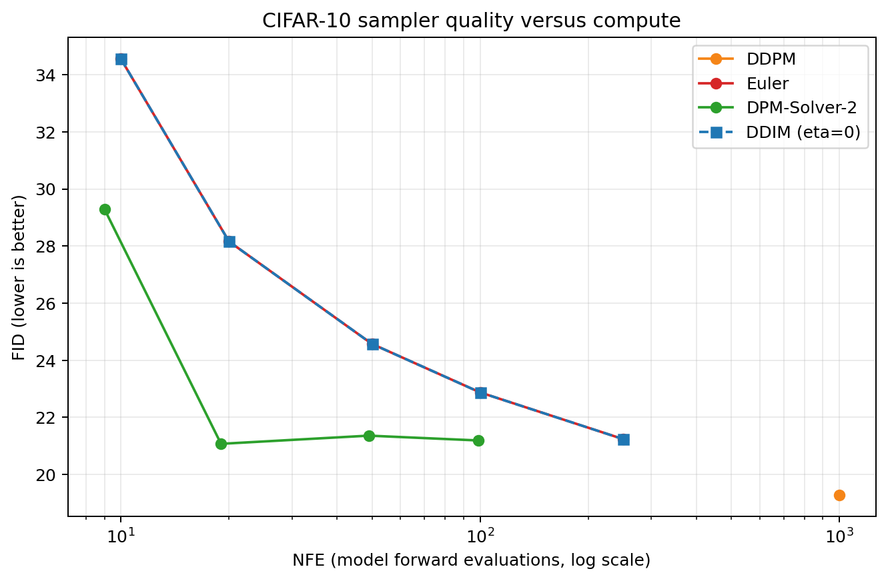

# Project 2: 采样器对比 (DDIM / DPM-Solver / Euler) 实验报告

本项目直接复用项目 1 已训练的 CIFAR-10 epsilon-prediction U-Net，比较不同采样器的生成质量、模型调用次数（NFE）和 DDIM 反演效果。代码、配置、测量结果和图表均保存在本目录。

## 一、实现内容

| 方法 | 实现与用途 |
|---|---|
| DDPM ancestral | 完整 1,000 步随机采样，作为基线。 |
| DDIM | 支持跳步、线性或二次时间步及 `eta`；`eta=0` 时为确定性采样。 |
| Euler | Probability-flow 一阶采样。当前实现与 `eta=0` 的 DDIM 使用相同的离散更新。 |
| DPM-Solver-2 | 基于指数中点法的二阶求解器；`S` 个外层步实际调用模型 `2S-1` 次。 |
| DDIM inversion | 将图像反演到噪声潜变量，再确定性重构并测量误差。 |

### 二、实验结果

| 采样器 | 步数 / 外层步 | NFE | FID ↓ | 采样时间 |
|---|---:|---:|---:|---:|
| DDPM | 1,000 | 1,000 | **19.290** | 1,010.7 s |
| DDIM (`eta=0`) | 10 | 10 | 34.555 | 10.1 s |
| DDIM (`eta=0`) | 20 | 20 | 28.159 | 20.1 s |
| DDIM (`eta=0`) | 50 | 50 | 24.574 | 50.9 s |
| DDIM (`eta=0`) | 100 | 100 | 22.875 | 100.6 s |
| DDIM (`eta=0`) | 250 | 250 | 21.241 | 251.9 s |
| Euler | 10 | 10 | 34.555 | 10.1 s |
| Euler | 20 | 20 | 28.159 | 20.3 s |
| Euler | 50 | 50 | 24.574 | 50.4 s |
| Euler | 100 | 100 | 22.875 | 100.9 s |
| Euler | 250 | 250 | 21.241 | 251.4 s |
| DPM-Solver-2 | 5 | 9 | 29.295 | 9.3 s |
| DPM-Solver-2 | 10 | 19 | **21.074** | 19.3 s |
| DPM-Solver-2 | 25 | 49 | 21.361 | 49.4 s |
| DPM-Solver-2 | 50 | 99 | 21.192 | 100.5 s |

在这组固定权重和协议下，DDPM 的绝对 FID 最低，但需要 1,000 NFE。DPM-Solver-2 在 19 NFE 时 FID 为 21.074，比相近预算的 DDIM（20 NFE，28.159）低 7.085。**DDIM 和 Euler 的测量曲线重合，符合本实现中 `eta=0` DDIM 与一阶 probability-flow Euler 更新相同的离散形式。**

此外，仓库记录了另一组独立实验：使用项目 1 的 R5 EMA 0.9999 权重 `r5_uniform_late_decay_final.pt`（[challenge-v1 Release](https://github.com/li-cheng111/my-diffusion-models-starter/releases/tag/challenge-v1)，做 DDIM 评估，真实图、生成 seed 和生成图数量与正式协议相同。**可见，即便DDPM的模型训练得更好，对于低步数的DDIM也不一定有正面的提升。**

| DDIM NFE | 10 | 20 | 50 | 100 | 250 |
|---|---:|---:|---:|---:|---:|
| R5 FID ↓ | 53.091 | 33.610 | 23.121 | 20.111 | **18.362** |

数据见 [`results/p1_r5_ddim_5k.json`](results/p1_r5_ddim_5k.json)，250 NFE 样图见 [`samples/r5_baseline/ddim_nfe250.png`](samples/r5_baseline/ddim_nfe250.png)。

## 三、采样轨迹对比

轨迹实验对四种方法传入同一个初始噪声 tensor，减少随机起点造成的差异。下列数据使用 CIFAR-10 seed 44 EMA 模型、初始噪声 seed 44；DDIM、Euler 使用 50 步，DPM-Solver-2 使用 50 个外层步。

| 采样器 | 步数 | 实际 NFE | 平均单步 L2 | 最大单步 L2 | 终点距初始噪声 L2 |
|---|---:|---:|---:|---:|---:|
| DDPM ancestral | 1,000 | 1,000 | 5.2548 | 8.0443 | 67.5356 |
| DDIM (`eta=0`) | 50 | 50 | 1.1307 | 3.2183 | 53.7210 |
| Euler | 50 | 50 | 1.1307 | 3.2183 | 53.7210 |
| DPM-Solver-2 | 50 | 99 | 1.1225 | 4.2199 | 53.0901 |

## 四、DDIM 反演与重构

反演使用 CIFAR-10 测试集前 64 张图，按采样时间步的反方向运行；往返过程关闭 `x0` 裁剪，避免裁剪影响重构误差。表中指标是 64 张图逐图测量后的均值。

| 步数 | 平均 L2  | MAE  | MSE  | PSNR  |
|---:|---:|---:|---:|---:|
| 10 | 18.2820 | 0.26955 | 0.11417 | 15.891 dB |
| 20 | 12.5195 | 0.18369 | 0.05343 | 19.175 dB |
| 50 | 5.0287 | 0.07314 | 0.00864 | 27.057 dB |
| 100 | 2.3665 | 0.03419 | 0.00197 | 33.644 dB |
| 250 | **0.9316** | **0.01332** | **0.00032** | **41.836 dB** |

## 五、原理方法说明与适用范围

DDIM 根据噪声预测估计干净样本：

$$
\hat{x}_0=\frac{x_t-\sqrt{1-\bar{\alpha}_t}\,\epsilon_\theta(x_t,t)}
{\sqrt{\bar{\alpha}_t}}.
$$

对跳步 `t > t_prev`，更新为：

$$
\begin{aligned}
\sigma_t^2 &= \eta^2\frac{1-\bar{\alpha}_{t_{prev}}}{1-\bar{\alpha}_t}
\left(1-\frac{\bar{\alpha}_t}{\bar{\alpha}_{t_{prev}}}\right),\\
x_{t_{prev}} &= \sqrt{\bar{\alpha}_{t_{prev}}}\hat{x}_0
+\sqrt{1-\bar{\alpha}_{t_{prev}}-\sigma_t^2}\,\epsilon_\theta
+\sigma_t z.
\end{aligned}
$$

`eta=0` 时 `sigma=0`，固定权重、时间步和初始噪声后采样结果确定。`eta` 增大时会注入额外噪声，可能增加多样性，也会改变低步数下的保真度。实现会保护平方根和除法的数值范围；普通生成默认裁剪 `x0` 到 `[-1,1]`，反演与重构不裁剪。

DPM-Solver-2 令 `lambda = log(alpha / sigma)`，在 lambda 中点进行二阶指数积分。每个中间区间调用模型两次，最后的终止步只需一次，因此实际 NFE 为 `2S-1`。本实验使用 lambda 时间步；报告的 NFE 由采样器调用次数验证。

当 DDIM 不裁剪 `x0`、采用连续相邻训练时间步，并令随机方差等于 DDPM posterior variance

$$
\tilde{\beta}_t=\frac{1-\bar{\alpha}_{t-1}}{1-\bar{\alpha}_t}\beta_t,
$$

其更新可化为 DDPM ancestral 更新。跳步时即使 `eta=1`，也只是类似 DDPM 的随机更新，并非原始 DDPM Markov 链。

## 六、验证与结果文件说明

| 文件 | 内容 |
|---|---|
| `runs/benchmark_all.json` | 15 个正式配置、FID、NFE、耗时、checkpoint 摘要和运行环境。 |
| `runs/benchmark_ddim.json` | 五个 DDIM 步数的独立结果。 |
| `runs/pareto_fid_nfe.png` | 完整 FID–NFE Pareto 图。 |
| `runs/trajectory_comparison.json`、`runs/trajectory_comparison.png` | 共同初始噪声下的轨迹指标和图像。 |
| `runs/inversion_results.json`、`runs/inversion_errors.png` | 反演重构指标和误差图。 |
| `results/p1_r5_ddim_5k.json`、`results/p1_r5_ddim_5k.png` | Project 1 R5 checkpoint 的独立 DDIM 对照。 |
