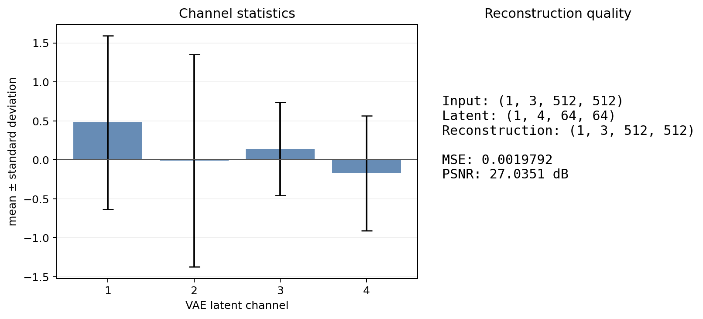

# Project 3：Stable Diffusion 实验报告

## 一. 实验内容

本项目以 Stable Diffusion 1.5 为对象，逐段复现并检查文本到图像的 latent diffusion 路径，完成手写推理、参数扫描、VAE 解剖、LoRA 微调、Canny ControlNet、cross-attention 可视化，以及 LDM/SDXL 阅读笔记。

| 作业模块 | 结果 | 相关文件 |
|---|---|---|
| A：不调用高层 pipeline 的手写推理 | 已完成并保留 notebook 输出 | 01_inference_walkthrough.ipynb、outputs/manual/ |
| B：CFG、steps、sampler 对比 | 已完成 full preset，seed 42 | outputs/sweep/、metadata.json |
| C：VAE latent 通道与重构 | 已执行，含四通道图、crop、MSE/PSNR | 05_vae_anatomy.ipynb、outputs/vae_*.png、vae_metrics.json |
| D：LoRA 微调、分段保存、独立加载 | 完成 800 optimizer steps | outputs/lora/full/、outputs/lora/full_eval/ |
| E：Canny ControlNet 与 attention challenge | 四种风格、结构/文本冲突、四个 token attention map | outputs/controlnet/、outputs/attention/full/ |
| LDM §3–4 与 SDXL 阅读笔记 | 已完成 | notes/reading_note_ldm.md、reading_notes/ldm_sdxl_reading_note.md |
| 环境、复现与 debug | 环境快照、运行日志和真实问题记录 | outputs/autodl_environment.json、logs/、本报告第 10 节 |

## 二. Stable Diffusion 结构

文本到图像的主要张量流：

**prompt → tokenizer → CLIP text encoder → text embedding；
随机 latent → UNet + CFG + scheduler → 去噪 latent → VAE decoder → RGB 图像。**

对于 SD 1.5、512×512 输入/输出：

| 阶段 | 张量 shape | 来源/含义 |
|---|---|---|
| token ids | (1, 77) | CLIP 固定长度 padding/truncation |
| text embedding | (1, 77, 768) | CLIP 序列长度 77、hidden size 768 |
| 初始 latent | (1, 4, 64, 64) | 图像经 VAE 下采样 8 倍；4 为 latent channels |
| CFG UNet 输入 embedding | (2, 77, 768) | unconditional 与 conditional embedding 沿 batch 拼接 |
| 去噪 latent | (1, 4, 64, 64) | UNet 预测与 scheduler 更新后的 latent |
| 解码 RGB | (1, 3, 512, 512) | 解码前按 VAE scaling factor 0.18215 还原 latent 尺度 |

## 三. 任务A：Stable Diffusion 推理框架实现

文件：01_inference_walkthrough.ipynb，该 notebook 逐步运行 tokenizer、CLIP、噪声初始化、DDIM、CFG、scheduler 更新和 VAE decode。

固定配置：prompt 为 **astronaut/horse/mars** 场景，negative prompt 为 **low quality, blurry, distorted**，seed=42，50 个 DDIM steps，CFG=7.5。

### 采样过程中的 latent 统计

| 循环 step | scheduler timestep | mean | std | min | max |
|---:|---:|---:|---:|---:|---:|
| 0 | 981 | 0.00173 | 0.99620 | -3.92188 | 3.92578 |
| 9 | 801 | -0.00029 | 0.98591 | -3.81445 | 3.77148 |
| 24 | 501 | -0.00298 | 0.94525 | -3.60352 | 3.93555 |
| 49 | 1 | -0.00781 | 0.80868 | -4.90625 | 5.94922 |

**分析结论：** 生成图能同时呈现 astronaut、horse 与 Mars，说明 tokenizer、文本编码、CFG、UNet/scheduler 更新到 VAE 解码的手写链路已贯通。采样记录中 latent 均值始终接近 0，标准差从 `0.9962` 降至 `0.8087`；这描述的是 scheduler 更新后 latent 的数值变化，不是“剩余噪声比例”或图像质量分数，不能单独据此判断去噪质量。

产物：[手写推理生成图](https://raw.githubusercontent.com/li-cheng111/my-diffusion-models-starter/6b14f26cd7ea2a67d3b231a97cde80baea636ca2/projects/project3_stable_diffusion/outputs/manual/manual_sd_seed42.png)、[latent 统计 JSON](https://raw.githubusercontent.com/li-cheng111/my-diffusion-models-starter/6b14f26cd7ea2a67d3b231a97cde80baea636ca2/projects/project3_stable_diffusion/outputs/manual/manual_sd_stats.json)。

<strong>图 1｜手写推理生成结果</strong> seed=42、50 DDIM steps、CFG=7.5

### Reading Notes：LDM和SDXL
链接：[reading_note_ldm.md](https://github.com/li-cheng111/my-diffusion-models-starter/blob/main/projects/project3_stable_diffusion/notes/reading_note_ldm.md)

## 四. 任务B：CFG、steps 与 sampler 扫描

脚本：02_parameter_sweep.py。full preset 在同一 prompt、negative prompt 和 seed=42 下改变一个因素或绘制二维交互图。prompt 为 **“a photograph of a cat wearing a wizard hat, fantasy art”**，negative prompt 为 **“low quality, blurry”**；输出尺寸 512×512。

| 对比量 | 扫描配置 | 控制变量/结果图 |
|---|---|---|
| CFG scale | 1、3、7.5、15、25 | 其余配置固定；sweep_cfg.png |
| inference steps | 10、20、50、100 | CFG=7.5；sweep_steps.png |
| sampler | DDIM、Euler-A、DPM++ 2M | 30 steps、CFG=7.5；sweep_sampler.png |
| CFG × steps | CFG=3、7.5、15 × steps=10、20、50 | 3×3 grid_2d.png |

输出按 metadata 记录 16 个 PNG 文件：12 张独立条件结果、1 张含 9 个样本格的二维网格、3 张横向汇总图。

### 实测图

<strong>图 2a｜CFG scale 对照</strong> 固定 prompt、seed=42 与其余设置，比较 CFG=1、3、7.5、15、25。

<strong>图 2b｜采样步数对照</strong> 固定 CFG=7.5，比较 10、20、50、100 steps。

<strong>图 2c｜Sampler 对照</strong> 固定 30 steps 与 CFG=7.5；sampler 更新方式不同，因此同 seed 不保证像素一致。

<strong>图 2d｜CFG × steps 交互</strong> 行列分别对应 CFG=3、7.5、15 与 steps=10、20、50；这是子网格，不是完整 5×4 组合。

**分析结论：**

- **CFG 控制条件遵循强度，不是质量旋钮。** CFG=1 时 prompt 特征较弱；3–7.5 时猫与巫师帽更易辨认；15–25 虽然颜色和局部对比更强，但开始过饱和、眼部等细节变形。本组图的平衡点约在 7.5，不能据单一 prompt 推成通用最优值。
- **步数增加有明显的边际递减。** 10 步的轮廓较软，20 步主要结构已成形；50 步后细节趋稳，100 步相较 50 步的可见收益有限。对这组设置，50 步是质量与计算量较合适的折中。
- **Sampler 改的是去噪轨迹，而非简单“锐化滤镜”。** DDIM 与 DPM++ 2M 保留了相近的猫/巫师帽主题；Euler-A 的构图、光照和背景变化更大。同 seed 不代表不同 solver 会逐像素相同，也不能据这一个样本判定哪种 sampler 普遍更优。
- **CFG 与步数不能互相替代。** 二维网格中，增大 CFG 能强化语义和色彩，却不能弥补低步数下尚未充分细化的结构；因此应先保证足够的采样步数，再按 prompt 调 CFG。

以上均为固定 seed、单 prompt 的视觉观察，没有盲评或质量指标，结论限于本次样例。

高清图像链接：[sweep_cfg.png](https://raw.githubusercontent.com/li-cheng111/my-diffusion-models-starter/6b14f26cd7ea2a67d3b231a97cde80baea636ca2/projects/project3_stable_diffusion/outputs/sweep/sweep_cfg.png) · [sweep_steps.png](https://raw.githubusercontent.com/li-cheng111/my-diffusion-models-starter/6b14f26cd7ea2a67d3b231a97cde80baea636ca2/projects/project3_stable_diffusion/outputs/sweep/sweep_steps.png) · [sweep_sampler.png](https://raw.githubusercontent.com/li-cheng111/my-diffusion-models-starter/6b14f26cd7ea2a67d3b231a97cde80baea636ca2/projects/project3_stable_diffusion/outputs/sweep/sweep_sampler.png) · [grid_2d.png](https://raw.githubusercontent.com/li-cheng111/my-diffusion-models-starter/6b14f26cd7ea2a67d3b231a97cde80baea636ca2/projects/project3_stable_diffusion/outputs/sweep/grid_2d.png)

## 五. 任务C：VAE anatomy

文件：05_vae_anatomy.ipynb。使用 encoder posterior 的 mode，记录四个 latent channel、原图/重构图、局部细节 crop 和 metrics JSON。

| 张量 | shape |
|---|---|
| 输入 RGB | (1, 3, 512, 512) |
| latent | (1, 4, 64, 64) |
| 重构 RGB | (1, 3, 512, 512) |

**实测 MSE = 0.0019791808，PSNR = 27.0351 dB。** 四个通道统计如下：

| latent channel | mean | std |
|---:|---:|---:|
| 1 | 0.47984 | 1.11195 |
| 2 | -0.01039 | 1.36113 |
| 3 | 0.14115 | 0.59798 |
| 4 | -0.17118 | 0.73707 |

 <strong>A · 四个 latent 通道</strong>

<table>
  <tr>
    <td align="center" width="33%"> <strong>B · 输入与重构对比</strong></td>
    <td align="center" width="33%"> <strong>C · 局部细节</strong></td>
    <td align="center" width="33%"> <strong>D · 通道统计与重构指标</strong></td>
  </tr>
</table>

<strong>图 3｜VAE anatomy：通道、重构与指标</strong> A：四个 latent channel；B：输入/重构；C：局部细节；D：通道统计和 MSE/PSNR。

原始图链接：[vae_channels.png](https://raw.githubusercontent.com/li-cheng111/my-diffusion-models-starter/6b14f26cd7ea2a67d3b231a97cde80baea636ca2/projects/project3_stable_diffusion/outputs/vae_channels.png) · [vae_reconstruction.png](https://raw.githubusercontent.com/li-cheng111/my-diffusion-models-starter/6b14f26cd7ea2a67d3b231a97cde80baea636ca2/projects/project3_stable_diffusion/outputs/vae_reconstruction.png) · [vae_detail_crop.png](https://raw.githubusercontent.com/li-cheng111/my-diffusion-models-starter/6b14f26cd7ea2a67d3b231a97cde80baea636ca2/projects/project3_stable_diffusion/outputs/vae_detail_crop.png) · [vae_statistics.png](https://raw.githubusercontent.com/li-cheng111/my-diffusion-models-starter/6b14f26cd7ea2a67d3b231a97cde80baea636ca2/projects/project3_stable_diffusion/outputs/report/vae_statistics.png)

**分析结论：** 本次 `vae_metrics.json` 记录的输入是 `outputs/sweep_smoke/grid_2d.png`，即带有小图和文字标签的参数扫描拼图，不是自然图像基准。MSE=`0.001979`、PSNR=`27.04 dB` 只衡量这张输入与重构图的像素差异；图中大块明暗与主体轮廓基本保留，但细边缘、网格分隔和小字更容易变软。四个 latent 通道的标准差为 `0.598–1.361`，显示它们是统计特性不同的学习表征，而不是 RGB 的一一对应通道。该单图结果可说明压缩/重构现象，不能推广成 VAE 对自然图像的总体保真度结论。

## 六. 任务D：LoRA 风格微调与独立加载

文件：03_lora_finetune.py、evaluate_lora.py。

### 训练实现与配置

- 冻结 VAE、text encoder 和基础 UNet，仅在 UNet attention 的 to_q、to_k、to_v、to_out.0 注入 LoRA。
- rank=8、alpha=8；LoRA master 参数保持 FP32，前向采用 FP16 autocast/GradScaler。
- 输入训练分辨率 512×512，batch size=1，AdamW，learning rate=1e-4，800 optimizer steps，seed=42。
- 开启 gradient checkpointing，max_grad_norm=1.0；每 200 步保存 adapter checkpoint、验证图和 JSONL 训练记录。
- 数据集共 20 张镜像图，训练 instance prompt 为 **“a painting in the style of van gogh”。**

### LoRA评估

evaluate_lora.py 在独立 SD pipeline 中评估 base、checkpoint-0200、0400、0600、0800。比较使用 seed=42、20 inference steps、CFG=7.5，四个实际 prompt 分别为 **“a lighthouse by the sea in sks style”“a quiet street at night in sks style”“a vase of sunflowers in sks style”“a mountain landscape in sks style”**，因此得到 5 个模型状态 × 4 个固定 prompt 的 20 张对比图。

<strong>图 4b｜LoRA adapter 独立加载对照</strong> 列为 base、200、400、600、800 steps；行对应 lighthouse、street、sunflowers、mountain。

原始图：[lora_before_after.png](https://raw.githubusercontent.com/li-cheng111/my-diffusion-models-starter/6b14f26cd7ea2a67d3b231a97cde80baea636ca2/projects/project3_stable_diffusion/outputs/lora/full_eval/lora_before_after.png)

**分析结论：** 首个记录 loss 为 `0.2810`、末步为 `0.1527`，但最后 50 步均值是 `0.2282`；batch=1 下单步 loss 波动明显，因此只能说末步低于首步，不能声称全程单调收敛。对照图中，200 步已能看到更明显的笔触和色彩风格变化，之后变化较渐进；部分画面也出现类似伪字/签名的细节，说明风格增强不等于所有内容质量持续提高。另一个关键限制是训练 prompt 为 `a painting in the style of van gogh`，评估 prompt 却使用 `in sks style`：本实验验证了 adapter 可脱离训练进程加载并改变输出，但不能据此说 `sks` 是学到的触发词，或严格量化风格泛化能力。

## 七. 任务E：Canny ControlNet 与 cross-attention

### 1） Canny ControlNet

文件：04_controlnet_demo.ipynb。输入图先用 Canny 提取边缘（thresholds=[100, 200]），然后固定结构，使用四种 prompt 做重绘；另加要求 **“a realistic golden retriever dog, high detail”** 的冲突 prompt，观察文本与边缘条件争夺控制权。生成 seed=42。

四种风格 prompt 为现代油画、漫画、赛博朋克角色、Pixar 3D 渲染，分别保存结果并组合成网格：

 <strong>A · 输入图与 Canny 边缘</strong>

<table>
  <tr>
    <td align="center" width="50%"> <strong>B · 现代油画</strong></td>
    <td align="center" width="50%"> <strong>C · 漫画</strong></td>
  </tr>
  <tr>
    <td align="center" width="50%"> <strong>D · 赛博朋克</strong></td>
    <td align="center" width="50%"> <strong>E · Pixar 3D</strong></td>
  </tr>
</table>

 <strong>F · 固定边缘与 golden retriever 文本冲突</strong>

<strong>图 5a｜Canny ControlNet 条件实验</strong> A：输入与边缘图；B–E：四种风格 prompt；F：结构/文本冲突。统一 seed=42。

原始图：[control_input_and_canny.png](https://raw.githubusercontent.com/li-cheng111/my-diffusion-models-starter/6b14f26cd7ea2a67d3b231a97cde80baea636ca2/projects/project3_stable_diffusion/outputs/controlnet/control_input_and_canny.png) · [controlnet_grid.png](https://raw.githubusercontent.com/li-cheng111/my-diffusion-models-starter/6b14f26cd7ea2a67d3b231a97cde80baea636ca2/projects/project3_stable_diffusion/outputs/controlnet/controlnet_grid.png) · [controlnet_conflict_dog_on_same_edges.png](https://raw.githubusercontent.com/li-cheng111/my-diffusion-models-starter/6b14f26cd7ea2a67d3b231a97cde80baea636ca2/projects/project3_stable_diffusion/outputs/controlnet/controlnet_conflict_dog_on_same_edges.png)

**分析结论：** 四种 prompt 明显改变了画面的色调和渲染质感，同时保留了输入的主要轮廓/布局，体现了“结构条件”和“文本风格”可以分工控制。但本次输入本身是由多个小图与标签构成的复杂拼图，边缘条件并非干净的单一物体轮廓；冲突结果也没有清晰呈现金毛犬。因此它只能说明该输入和当前控制强度下，复杂边缘会强烈约束构图，不能作为“ControlNet 总会压过 prompt”的证据。后续若要比较猫/狗语义冲突，应换用轮廓清楚的单物体输入，并固定其他参数做成对对照。

### 2） Cross-attention challenge

脚本：06_cross_attention_visualization.py。prompt 为 **“a red cat wearing a blue wizard hat in a green forest”**，seed=42、30 steps、CFG=7.5。自定义 attention processor 在 CFG 条件分支采集 prompt 相关 attention，在去噪中后段聚合 16×16 和 32×32 query map，并排除 BOS、EOS 及 padding token。

有效 token 为 cat、wizard、hat、forest，token indices 分别是 3、7、8、12；metadata 记录了 32 个 attention 模块名、两种空间分辨率、token IDs。

<table>
  <tr>
    <td align="center" width="50%"> <strong>A · cat</strong></td>
    <td align="center" width="50%"> <strong>B · wizard</strong></td>
  </tr>
  <tr>
    <td align="center" width="50%"> <strong>C · hat</strong></td>
    <td align="center" width="50%"> <strong>D · forest</strong></td>
  </tr>
</table>

<strong>图 5b｜Cross-attention token 空间响应</strong> 每格左侧是同一生成图，右侧是对应 token 的 attention map；热图表示模型响应，不是像素级分割真值。

原始图链接：[generated.png](https://raw.githubusercontent.com/li-cheng111/my-diffusion-models-starter/6b14f26cd7ea2a67d3b231a97cde80baea636ca2/projects/project3_stable_diffusion/outputs/attention/full/generated.png) · [attention_03_cat_w.png](https://raw.githubusercontent.com/li-cheng111/my-diffusion-models-starter/6b14f26cd7ea2a67d3b231a97cde80baea636ca2/projects/project3_stable_diffusion/outputs/attention/full/attention_03_cat_w.png) · [attention_07_wizard_w.png](https://raw.githubusercontent.com/li-cheng111/my-diffusion-models-starter/6b14f26cd7ea2a67d3b231a97cde80baea636ca2/projects/project3_stable_diffusion/outputs/attention/full/attention_07_wizard_w.png) · [attention_08_hat_w.png](https://raw.githubusercontent.com/li-cheng111/my-diffusion-models-starter/6b14f26cd7ea2a67d3b231a97cde80baea636ca2/projects/project3_stable_diffusion/outputs/attention/full/attention_08_hat_w.png) · [attention_12_forest_w.png](https://raw.githubusercontent.com/li-cheng111/my-diffusion-models-starter/6b14f26cd7ea2a67d3b231a97cde80baea636ca2/projects/project3_stable_diffusion/outputs/attention/full/attention_12_forest_w.png)

**分析结论：** 热图呈现了 token 的空间响应差异，但 cat、wizard、hat 的响应并不总与对应物体轮廓一一重合，且彼此有重叠、向上下文扩散的现象；forest 的响应也覆盖较大背景区域。这说明 cross-attention 提供的是 token—空间软关联，不是目标检测或像素级分割。这里的图还聚合了多个层、时间步，并只显示 16×16/32×32 分辨率，适合观察关注趋势，不宜把亮区当成精确物体边界或因果解释。

## 八. 自查问题与回答

### 推理与采样

1. **把 `cfg=0`（无 guidance）会生成什么？为什么？** 按公式 `ε = ε_uncond + cfg × (ε_cond − ε_uncond)`，`cfg=0` 时 `ε=ε_uncond`，所以 UNet 每步使用空 prompt 的 unconditional 预测，生成不受正向 prompt 引导的图像。
2. **只用 `cond_emb`、不做 batch concat，结果会怎样？** 若只做一次 conditional 前向并直接采用 `ε_cond`，仍会按 prompt 生成，但没有 `ε_uncond`，不能计算 CFG 差值；按 `ε = ε_uncond + cfg × (ε_cond − ε_uncond)`等价于 `cfg=1`。
3. **把 `init_noise_sigma` 改成 `0.5` 会怎样？** 初始 `z` 的形状不变，但幅度变成预期的一半、方差变为四分之一（相对于原缩放），与 scheduler 的初始噪声分布不匹配。后续每一步仍按原噪声日程去噪，因此轨迹偏离采样设定，可能导致结构、对比度和细节变差`。
4. **在采样循环里打印 `z` 的统计量——它的演化和 DDPM 训练时的 forward process 反过来是否一致？** 只能说总体方向相反，不能说统计曲线严格镜像。forward 满足 `zₜ=√ᾱₜ z₀+√(1−ᾱₜ)ε`，时间步增大时，干净信号的系数变小、噪声占比变大；采样则从近似纯噪声开始，逐步恢复 latent 结构。反向统计量由 UNet 预测和 scheduler 更新共同决定，不会逐点复现 forward 的反向曲线。
5. **把 `num_steps` 改成 5，结合 L07 解释为什么质量这么差。** [L07](https://github.com/Qi-StarterTrain/diffusion-models-starter-materials/blob/main/paper_notes/07_LDM_Rombach2022.md) 所讲的 LDM 流程中，UNet 在每个时间步预测噪声，scheduler 据此推进 latent。若按 5 步蒸馏训练，这意味着只做很少次修正、每次跨越较大的噪声区间，局部预测误差容易累积，构图和语义尚未稳定时采样就结束，所以细节、结构和 prompt 对齐通常较差。即，步数少会更快，但速度与质量存在取舍。

### ControlNet 条件控制

6. **ControlNet 为什么不直接改 SD UNet，而要复制一份再加？** 直接微调原 UNet 会改变已有权重，可能损伤其通用生成能力。ControlNet 冻结原模型，并用原权重初始化一份可训练的编码层和中间层；条件图经该分支提取多尺度特征，再注入原 UNet。这样既利用预训练特征学习控制，又保留原模型作为稳定主干。
7. **Zero convolution 初始化为 0 有什么意义？训练后还是 0 吗？** 零初始化让控制分支开始时输出为零，刚接入时不会扰动原 SD 的行为；训练后这些卷积参与优化，通常会变成非零权重，以学习有效的条件 residual。
8. **ControlNet 条件与 prompt 冲突时（canny 是猫、prompt 说狗），SD 怎么处理？** Canny 主要提供轮廓和空间布局，不直接提供“猫”这个类别；文本 prompt 则提供“狗”的语义。UNet 同时接收两类条件，通常会尝试沿用边缘布局生成狗，但可能出现猫形轮廓与狗语义的折中或结构变形。结果受 ControlNet conditioning scale、CFG、seed 和模型先验影响，没有固定的胜出规则。
9. **ControlNet 推理比纯 SD 多多少计算？** 粗略看，每个去噪步都要额外运行 ControlNet 分支生成 residual，再运行原 SD UNet：`F_total ≈ F_SD + F_ControlNet`，额外比例取决于 `F_ControlNet / F_SD`，具体比例还依分辨率、batch、步数和实现而变

### Stable Diffusion 的经验与局限

10. **为什么 CFG 默认 7.5？** 7.5 是 SD 1.5 常见的经验默认值，不是由理论推导出的固定最优值。在 notebook 的公式中，它把 `ε_cond−ε_uncond` 的差异放大 7.5 倍，通常能加强 prompt 对齐；再提高可能过饱和或产生伪影，降低则可能使 prompt 约束变弱。最佳值取决于模型、prompt、scheduler 和任务。
11. **为什么 SD 出 512×512 而不是 1024×1024？** SD 1.5 的典型训练分辨率是 512×512，并非模型不能生成 1024。VAE 将 512 图像压到 `4×64×64` latent；改成 1024 时 latent 为 `4×128×128`，空间位置数变为 4 倍，显存和计算开销明显增加。高分辨率常采用分阶段放大或专门的高分辨率模型。
12. **为什么 SD 画不好文字？** SD 的文本条件主要帮助 **表达场景语义**，不是逐字排版监督；训练图文数据通常也**没有精确的字符位置/字形标注**。再加上 **512 分辨率和 VAE 压缩容易损失细笔画**，模型难以稳定保证拼写、字符数量和布局，因此文字常变形或拼错。

## 九. 代码、产物与 Release 索引

### 实验代码与仓库内结果

| 内容 | 主要代码 | 结果与记录 |
| --- | --- | --- |
| A · 手写推理 | [`01_inference_walkthrough.ipynb`](01_inference_walkthrough.ipynb) | [`outputs/manual/`](outputs/manual/) |
| B · 参数扫描 | [`02_parameter_sweep.py`](02_parameter_sweep.py) | [`outputs/sweep/`](outputs/sweep/)、[`outputs/sweep_smoke/`](outputs/sweep_smoke/) |
| C · VAE 解剖 | [`05_vae_anatomy.ipynb`](05_vae_anatomy.ipynb) | `outputs/vae_*.png`、[`outputs/vae_metrics.json`](outputs/vae_metrics.json) |
| D · LoRA 训练与评估 | [`03_lora_finetune.py`](03_lora_finetune.py)、[`evaluate_lora.py`](evaluate_lora.py) | [`outputs/lora/full/`](outputs/lora/full/)、[`outputs/lora/full_eval/`](outputs/lora/full_eval/) |
| E · ControlNet 与 cross-attention | [`04_controlnet_demo.ipynb`](04_controlnet_demo.ipynb)、[`06_cross_attention_visualization.py`](06_cross_attention_visualization.py) | [`outputs/controlnet/`](outputs/controlnet/)、[`outputs/attention/`](outputs/attention/) |
| 环境、实验日志与阅读笔记 | [`outputs/autodl_environment.json`](outputs/autodl_environment.json)、[`logs/`](logs/)、[`notes/`](notes/)、[`reading_notes/`](reading_notes/) | 实验环境、实验配置、运行记录及论文阅读笔记 |
| 报告图 | [`make_report_figures.py`](make_report_figures.py) | [`outputs/report/`](outputs/report/)；其他插图直接引用已提交的实验 PNG |

### GitHub Release

| 发布内容 | 说明 |
| --- | --- |
| [Project3 reproducibility v1.0 · `project3-v1.0`](https://github.com/li-cheng111/my-diffusion-models-starter/releases/tag/project3-v1.0) | GitHub Release 页面；另含该 tag 对应的自动生成源码归档 |
| [`project3-lora-vangogh-full.safetensors`](https://github.com/li-cheng111/my-diffusion-models-starter/releases/download/project3-v1.0/project3-lora-vangogh-full.safetensors) | 完整训练的 Van Gogh LoRA adapter，6,414,448 bytes（约 6.12 MiB） |
| [`commit.txt`](https://github.com/li-cheng111/my-diffusion-models-starter/releases/download/project3-v1.0/commit.txt) | 发布时对应的代码提交标识 |
| [`repro_manifest.json`](https://github.com/li-cheng111/my-diffusion-models-starter/releases/download/project3-v1.0/repro_manifest.json) · [仓库副本](repro_manifest.json) | 复现配置、训练环境、数据说明和 adapter 校验信息 |
