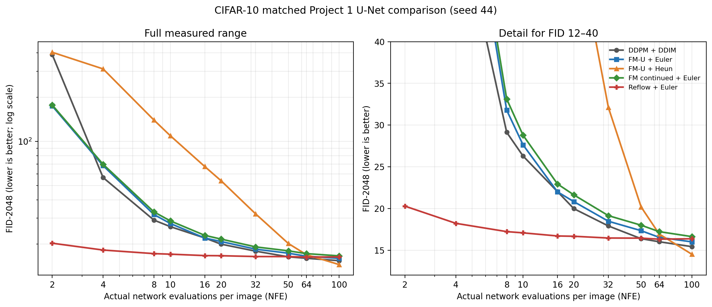

# Project 4：CIFAR-10 Flow Matching 实验报告

本报告覆盖 Rectified Flow 的线性路径与训练目标、Euler/Heun 数值积分、Classifier-Free Guidance（CFG）、NFE–FID 对比、进阶实验、自检问题、调试记录和复现材料。

## 1. 实验内容与设计

### 实验目标

Rectified Flow 直接学习从高斯噪声到数据样本的速度场。本实验实现无条件 FM、类别条件 FM 与 CFG，并比较 Euler、Heun 及若干训练变体。核心问题是：在同一 U-Net 与对齐评测预算下，FM 的采样质量如何随 NFE 改变；改变时间采样、训练轨迹或求解器后，结果是否改善。

### 总体实验设计

| 实验 | 模型与训练方式 | 训练设置 | 用途 |
| :---: | :--- | :---: | :--- |
| **D-U** | Project 1 U-Net，DDPM 目标 | 200,000 步 | DDIM 主基线；另测 ancestral 与 no-clip |
| **F-U** | Project 1 U-Net，无条件、均匀时间采样 FM | 200,000 步 | 核心 FM 对照；Euler 与 Heun 采样 |
| **F-CT** | 从 F-U checkpoint 初始化，继续 FM 训练 | 50,000 步<br>学习率 $2\times10^{-5}$ | 检查继续优化后的采样变化 |
| **F-RF** | 以 F-U 为教师生成配对轨迹，再训练 FM | 50,000 对<br>训练 50,000 步 | 检查 Reflow 对低 NFE 采样的影响 |
| **F-C** | Project 1 U-Net，类别条件 FM，标签 dropout = 10% | 200,000 步 | CFG 强度扫描 |
| **F-LN** | Project 1 U-Net，无条件 FM，logit-normal 时间采样 | 200,000 步 | 时间采样分布的进阶实验 |
| **F-DiT** | DiT-S，32.62M 参数，无条件 FM | 200,000 步 | 更换 backbone 的进阶实验 |

### 评测参数设置

| 项目 | 设置 |
|---|---|
| 数据 | CIFAR-10；真实图像取 train 集索引 0–4,999 |
| 指标 | TorchMetrics FID，Inception feature=2048，图像按 uint8 RGB 计算 |
| 每个测点样本量 | 5,000 张生成图像 |
| 评测 batch size | 64 |
| 生成随机种子 | 1001 |
| 固定噪声库 | 所有节点共享 |

## 2. Flow Matching 简单推导说明

设数据图像 $x_1\sim p_{data}$，独立噪声 $\epsilon\sim\mathcal{N}(0,I)$，时间 $t\sim U[0,1]$。使用从噪声到数据的直线路径：

$$
x_t=(1-t)\epsilon+t x_1.
$$

对 $t$ 求导得到该条件路径的目标速度：

$$
\frac{d x_t}{dt}=x_1-\epsilon.
$$

网络 $v_\theta(x_t,t)$ 通过条件 Flow Matching 损失拟合该速度：

$$
\mathcal{L}_{CFM}(\theta)=\mathbb{E}_{t,x_1,\epsilon}\left[\|v_\theta(x_t,t)-(x_1-\epsilon)\|_2^2\right].
$$

训练时逐样本随机抽取 $t$ 与 $\epsilon$，构造 $x_t$，然后以 $x_1-\epsilon$ 作为回归目标。采样从 $x(0)=\epsilon$ 开始，沿 $t:0\rightarrow1$ 积分到图像端。

### Euler 与 Heun

给定 $K$ 个等间隔积分步，$\Delta t=1/K$，Euler 更新为

$$
x_{k+1}=x_k+\Delta t\,v_\theta(x_k,t_k).
$$

Heun 先用 Euler 预测端点，再在区间两端的速度上取平均：

$$
\tilde{x}_{k+1}=x_k+\Delta t\,v_\theta(x_k,t_k),\qquad
x_{k+1}=x_k+\frac{\Delta t}{2}\left[v_\theta(x_k,t_k)+v_\theta(\tilde{x}_{k+1},t_{k+1})\right].
$$

Heun 每步需要两次网络评估，因此将它按实际 NFE 与 DDIM、Euler 对齐。

### CFG

F-C 训练时以 10% 概率将类别条件替换为 null 类别，使同一模型学会条件与无条件速度。采样时按下式外推：

$$
v_{CFG}(x,t,y)=v_\theta(x,t,\varnothing)+s\left[v_\theta(x,t,y)-v_\theta(x,t,\varnothing)\right],
$$

其中 $s$ 是 guidance scale。$s=0$ 对应无条件速度，$s=1$ 对应条件速度；$s>1$ 加强类别方向，但更强的条件约束可能牺牲样本变化并恶化整体质量。CFG 每个积分步要计算两种条件分支，故表中固定 20 个积分步对应 40 次网络调用。

## 3. 实验结果

###  U-Net 框架下各条件的 NFE–FID 曲线



下表给出测量曲线数据，FID 数值保留原始结果。

| NFE/图 | DDIM（D-U） | FM-U Euler | FM-U Heun | F-CT Euler | F-RF Euler |
|---:|---:|---:|---:|---:|---:|
| 2 | 389.6992 | 174.2554 | 404.2330 | 176.9113 | **20.2793** |
| 4 | 56.7488 | 68.3946 | 311.5474 | 69.8698 | **18.2201** |
| 8 | 29.1369 | 31.7916 | 139.7589 | 33.1324 | **17.2271** |
| 10 | 26.2918 | 27.6283 | 109.3425 | 28.7829 | **17.0783** |
| 16 | 22.0175 | 21.9929 | 67.4344 | 22.9350 | **16.7047** |
| 20 | 19.9765 | 20.8186 | 53.9351 | 21.6280 | **16.6678** |
| 32 | 17.9058 | 18.4714 | 32.1175 | 19.1418 | **16.4586** |
| 50 | **16.3803** | 17.3398 | 20.1862 | 17.9956 | 16.4426 |
| 64 | **16.0098** | 16.5395 | 16.9381 | 17.2232 | 16.3228 |
| 100 | 15.4242 | 15.9969 | **14.5048** | 16.6269 | 16.3683 |

表格中已用粗体标出每行 FID 最低的值。

F-RF 在 NFE 2–32 时最低，在 NFE 50–100 时 DDIM 最低；Heun 在 NFE 100 时最低。
普通 FM-U Euler 在 NFE 2、16 的结果略好于 DDIM，但在其他点都略差。

### CFG for FM

固定 Euler 20 个积分步（cond与uncond里各有 20 次调用，合计 NFE=40）：

| CFG scale | 实际 NFE/图 | FID ↓ | 采样时间（秒） |
|---:|---:|---:|---:|
| 1 | 40 | 18.5864 | 63.36 |
| 2 | 40 | **18.3478** | 61.89 |
| 3 | 40 | 23.0368 | 61.78 |
| 5 | 40 | 33.3663 | 61.08 |
| 7.5 | 40 | 46.1879 | 62.40 |

本次评测从 scale=3 开始出现 FID 明显退化，scale=5–7.5 退化更大。样本网格中，较高 scale 的类别特征更强、颜色和对比更极端；这只是单次网格的定性观察，不能单独证明多样性已经塌缩。图像可查看：[scale 1](results/fair_v1/F-C/cfg/fm_euler_nfe20_cfg_cfg1.png)、[scale 2](results/fair_v1/F-C/cfg/fm_euler_nfe20_cfg_cfg2.png)、[scale 7.5](results/fair_v1/F-C/cfg/fm_euler_nfe20_cfg_cfg7.5.png)。

## 4. 进阶实验

### 时间采样：logit-normal

F-LN 仍使用无条件的 U-Net 与 Euler 采样，训练时仅把 $t$ 的均匀采样改成 logit-normal。完整结果如下：

| Euler NFE/图 | FID | 采样时间（秒） |
|---:|---:|---:|
| 2 | 148.3074 | 3.90 |
| 4 | 59.5022 | 6.39 |
| 8 | 31.6195 | 12.27 |
| 10 | 28.1830 | 15.20 |
| 16 | 22.7265 | 24.47 |
| 20 | 21.6078 | 30.28 |
| 32 | 18.9864 | 48.35 |
| 50 | 17.7216 | 75.67 |
| 64 | 16.8549 | 96.67 |
| 100 | 16.2048 | 150.73 |

与均匀时间采样的 FM-U Euler 相比，F-LN 在 NFE 20、50、100 的 FID均略高。

## Heun 二阶 sampler


### Reflow 与继续训练

F-RF 使用 F-U 教师网络生成 50,000 对轨迹数据，再以这些配对训练 50,000 步。重新拟合教师输运轨迹会使学习目标更贴近教师生成的端点映射，目标是在有限求解步数下减小积分误差。

NFE=20 时，F-RF 的 FID 为 16.6678，对比 FM-U Euler 的 20.8186 与 DDIM 的 19.9765；NFE=100 时，F-RF 为 16.3683，略差于 FM-U Euler 的 15.9969 和 DDIM 的 15.4242。F-CT 是从 F-U 初始化后以较低学习率继续优化的模型，训练预算与主对照不同；它在各预算点均未超过 DDIM。两项结果说明，低 NFE 改善与训练轨迹/初始化有关，不能归结为 FM 目标本身。

### DiT-S backbone

F-DiT 使用 32.62M 参数 DiT-S，训练 200,000 步，但架构和网络容量都不同于 Project 1 U-Net。结果作为 backbone 进阶实验单独阅读：

| Euler NFE/图 | FID ↓ | 采样时间（秒） |
|---:|---:|---:|
| 2 | 294.5080 | 3.90 |
| 4 | 138.9369 | 6.74 |
| 8 | 61.0893 | 13.33 |
| 10 | 48.8798 | 16.68 |
| 16 | 33.2682 | 26.65 |
| 20 | **28.9317** | 33.52 |
| 32 | 30.2821 | 53.22 |
| 50 | 31.0744 | 82.93 |
| 64 | 31.7211 | 106.48 |
| 100 | 31.7707 | 166.95 |

FID 在 NFE=20 达到本表最低值，此后没有随 NFE 增加而下降。单次结果说明单纯增加采样调用数不能修正当前模型/训练配置的误差；由于架构不同，不能把该表与 U-Net 主对照合并为“FM 与 DDPM”的因果比较。

## 5. Project 4 自检问题

**1. 线性路径的速度目标如何得到？**

由 $x_t=(1-t)\epsilon+t x_1$ 对时间求导，得到 $u_t=x_1-\epsilon$。这个速度不依赖 $t$，但输入位置 $x_t$ 随 $t$ 改变；训练网络就是让 $v_\theta(x_t,t)$ 拟合该速度。

**2. 为什么 CFM 与 FM 的梯度相同，但损失值可以不同？**

记条件目标为 $U=u_t(x_t\mid x_1)$，给定 $(x_t,t)$ 的条件期望为 $m=\mathbb{E}[U\mid x_t,t]$，即边缘速度场。平方误差可分解为

$$
\mathbb{E}\|v_\theta-U\|^2=\mathbb{E}\|v_\theta-m\|^2+\mathbb{E}\|U-m\|^2.
$$

第二项是条件目标相对边缘速度的方差，与参数 $\theta$ 无关。因此两种目标对 $\theta$ 的梯度相同；但 CFM 数值包含额外的非负常数，训练损失值无需相等。

**3. 为什么低 NFE 下可能出现 FM 与 DDIM 的差距？本实验是否验证 FM 普遍占优？**

低 NFE 时，数值积分误差更受速度场曲率、轨迹长度、模型误差和求解器阶数影响；直线且易积分的轨迹可能在粗网格上有利，DDIM 也可能因其训练目标与离散采样器匹配而更稳。实际数据没有显示普通 FM-U 在整个低 NFE 区间稳定占优：NFE=2 时 FM-U Euler 更好，NFE=4 时 DDIM 更好，NFE=8–100 多数测点 DDIM 略好。表现突出的低预算方法是 F-RF，说明训练轨迹处理会改变比较结果。

**4. 为什么 Reflow 可能改善一步或少步采样？本实验验证到什么程度？**

教师模型先给噪声与生成端点建立配对，再用这些端点重新训练流场，减少训练目标对原始随机配对的依赖，使模型更贴近教师输运映射；若映射更直，少量离散步便可能覆盖更长路径而不产生过大误差。本实验在 NFE=2–32 上观察到 F-RF 优于 DDIM，但没有 NFE=1 测点，不能把“两次调用的结果”写成一步实测结论。

**5. 为什么 CFG 能用于速度场，形式为何类似 epsilon CFG？**

条件速度与无条件速度之差携带类别条件带来的方向变化。对两者线性外推，可以增强沿条件方向的分量，得到 $v_{uncond}+s(v_{cond}-v_{uncond})$。扩散模型的 epsilon 预测与速度/score 在固定时间状态下通过已知系数相关，因此用差分外推的形式相同；这并不保证较大的 $s$ 总能提升 FID，本次 scale=3 后的退化正体现了过强引导的代价。

## 6. 调试记录与实现验证

实现过程中记录了三类真实问题，完整复现和修复经过见[调试日志](fair_v1/debug_log.md)：

1. Heun 的解析 ODE 测试在 NFE=64 时误差约 $1.1\times10^{-4}$，超过原阈值；调整验证预算后确认误差随预算下降，并检查了 Heun 精度和 NFE 计数。
2. GPU 上 CFG 的 scale=1 与条件分支出现约 $8\times10^{-5}$ 的浮点差异；确认公式语义正确后，把边界容差改为 $5\times10^{-4}$，scale=0/1 检查通过。
3. 监控页前端拼接与复现文档曾有格式问题；修复后 Python 编译通过，本地服务页面和状态 API 均返回 HTTP 200，并能读到训练步数。

训练、评测、模型实现和配置入口见 [实验代码与运行说明](fair_v1/README.md)。NFE 曲线由 [`plot_report_curve.py`](plot_report_curve.py) 根据报告中的原始评测值生成。训练与评测日志、逐项 JSON、样图、运行 metadata、固定噪声库和 checkpoint 校验值都收录于 [Release 复现包](https://github.com/li-cheng111/my-diffusion-models-starter/releases/tag/project4-fair-v1.0)；各方法的完整 FID、耗时、权重哈希与资产列表见[结果归档](fair_v1/ARTIFACTS.md)。

从仓库根目录下载并校验完整实验资产：

```bash
bash projects/project4_flow_matching/fair_v1/download_artifacts.sh artifacts/project4 all
```

数据集未打包在 Release 中，需按 CIFAR-10 官方数据准备。Release 中包含可用于推理的 checkpoint 与复现所需源码、日志、评测结果及样图；逐文件 SHA-256 用于核验下载完整性。

## 7. 结论与限制

在相同 Project 1 U-Net 家族和主要训练设置下，普通 Flow Matching + Euler 没有在测量的 NFE 区间稳定优于 DDIM；中高 NFE 的 FID 略差，NFE=2 则更好。Reflow 在 NFE 2–32 显示了清楚的低预算优势，Heun 在高 NFE 100 获得本组最低 FID，但低 NFE 结果较差。Logit-normal 时间采样没有在本次代表性测点带来提升；类别 CFG 在 scale=2 达到本次最低 FID，scale 增至 3 以上后质量快速下降；DiT-S 曲线在 NFE=20 后没有改善。

评测通过相同真实数据、共同噪声库、相同样本量与固定 generation seed 尽量减少协议差异，但每个训练配置只有 seed 44 一次运行，FID 也只是有限样本估计。因而结论限于本次 CIFAR-10、模型与训练设置；跨种子方差、其他数据集和模型容量仍需额外实验验证。

核心比较将 Project 1 的 U-Net 用于 DDPM/DDIM 与无条件 Flow Matching（FM-U），两者使用相同的模型家族、200,000 次训练更新和主要优化设置。评测在相同 NFE、相同 5,000 张生成样本和共同噪声输入下完成。普通 FM-U 的 Euler 结果没有稳定优于 DDIM：在 NFE 20、50、100 时，FM-U 的 FID 分别为 20.8186、17.3398、15.9969，DDIM 分别为 19.9765、16.3803、15.4242。NFE=2 时 FM-U Euler 优于 DDIM，但 NFE=4 时反而略差，说明不能据单一点宣称 FM 普遍具有低步数优势。

Reflow 模型在 NFE 2–32 的 FID 为 16.46–20.28，明显低于本次普通 FM-U 和 DDIM 的相同预算结果；到 NFE 50–100，其优势缩小并略逊于 DDIM。Heun 在低预算下误差很大，在 NFE 100 时达到 FID 14.5048。观察结果依赖训练方式、轨迹、求解器与 NFE，不能简化成某一种方法在所有预算下更好。
