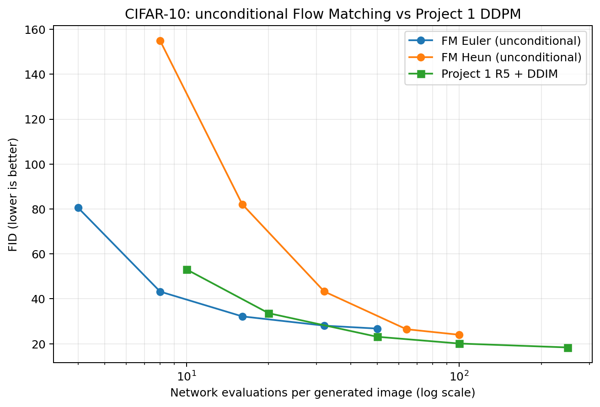

# Project 4：CIFAR-10 Flow Matching

本项目在 CIFAR-10 上训练 Rectified Flow 图像生成模型，实现 Euler、Heun 和
Classifier-Free Guidance（CFG）采样，并用 FID 与 Project 1 的 DDIM 基线比较。v2版本里无条件模型 FM-U 与类别条件模型 FM-C 均已训练 200K 步，权重和完整评测归档发布在 [GitHub Release `project4-v2.0`](https://github.com/li-cheng111/my-diffusion-models-starter/releases/tag/project4-v2.0)。

> 仓库还保留 v1 的配置、结果和复现清单，供历史参考。

## 一、方法与模型

线性路径从标准高斯噪声 `epsilon` 插值到数据图像 `x1`：

$$
x_t=(1-t)\epsilon+t x_1,\qquad
u_t=\frac{d x_t}{dt}=x_1-\epsilon,\qquad t\sim U[0,1].
$$

网络以均方误差预测速度场 `u_t`。采样从噪声端 `t=0` 积分到数据端 `t=1`：Euler
每步调用一次网络；Heun 先预测再校正，每步调用两次。表格中的 NFE 是每张图的实际
网络评估次数，不是积分步数。CFG 使用
`v = v_uncond + scale * (v_cond - v_uncond)`；其每步需两路预测，计算成本为普通采样的两倍。

| 实验 | 配置 | 训练方式 |
|---|---|---|
| FM-U | [`cifar10_fm_v2_unconditional.yaml`](configs/cifar10_fm_v2_unconditional.yaml) | 每个样本都使用 null 类别 token（`cond_drop_prob=1.0`），用于无条件生成 |
| FM-C | [`cifar10_fm_v2_conditional.yaml`](configs/cifar10_fm_v2_conditional.yaml) | 类别条件训练，10% 概率将标签替换为 null token，用于条件生成和 CFG |

两组模型都是 DiT-S，32.62M 参数，连续时间嵌入尺度为 1000。null token 的类别索引为
10（CIFAR-10 的 10 个类别索引为 0–9）。

## 环境、数据与训练

### 环境与依赖

| 参数 | 实际设置 |
|---|---|
| 运行平台 | AutoDL |
| GPU | NVIDIA GeForce RTX 4080 SUPER，32,760 MiB |
| Python | 3.12.3 |
| PyTorch / CUDA | PyTorch 2.8.0+cu128，CUDA 12.8 |
| TorchVision | 0.23.0+cu128 |
| TorchMetrics | 1.9.0 |
| 计算精度 | BF16 autocast |
| 项目依赖 | [requirements/project4.txt](../../requirements/project4.txt) |

### 数据

| 参数 | 实际设置 |
|---|---|
| 数据集与划分 | CIFAR-10 train |
| 图像规格 | 32 × 32，RGB |
| 训练变换 | 随机水平翻转；转为 Tensor 后按通道归一化到 [-1, 1] |
| DataLoader workers | 6 |
| 下载方式 | 实验使用固定镜像；训练脚本也支持 TorchVision 自动下载 |
| 归档文件 | [cifar-10-python.tar.gz](https://hf-mirror.com/datasets/MIT-OL-AI-D/cifar-10-python/resolve/a48007227f9e2cd0af96175f4afb5ac4965e261b/cifar-10-python.tar.gz) |
| 归档大小 | 170,498,071 字节 |
| MD5 | c58f30108f718f92721af3b95e74349a |

### 训练配置

| 参数 | FM-U（无条件） | FM-C（类别条件） |
|---|---|---|
| 配置文件 | [cifar10_fm_v2_unconditional.yaml](configs/cifar10_fm_v2_unconditional.yaml) | [cifar10_fm_v2_conditional.yaml](configs/cifar10_fm_v2_conditional.yaml) |
| 条件 dropout 概率 | 1.0；所有样本使用 null token | 0.1；随机将标签替换为 null token |
| 输出目录 | runs/fm_v2_unconditional | runs/fm_v2_conditional |

| 两组共用参数 | 实际设置 |
|---|---|
| 模型 | DiT-S，32.62M 参数；embed dim 384、depth 12、6 heads、patch size 2 |
| 时间嵌入尺度 | 1000 |
| 优化器 | AdamW；learning rate 2e-4；weight decay 0 |
| Batch size | 64 |
| 训练步数 | 200,000 optimizer steps |
| 随机种子 | 42 |
| 梯度裁剪 | 1.0 |
| EMA decay | 0.999、0.9995、0.9999 |
| 学习率计划 | 前 2,000 步 warmup；从 100,000 步起 cosine decay；最低为初始学习率的 0.1 |
| 日志频率 | 每 100 步 |
| checkpoint 频率 | 每 10,000 步更新 latest.pt；每 50,000 步保存快照 |
| 可恢复状态 | 模型、优化器、scheduler、EMA、随机数生成器状态 |

| 实测训练记录 | FM-U | FM-C |
|---|---:|---:|
| 完成步数 | 200,000 | 200,000 |
| 最终 loss | 0.2013 | 0.1665 |
| checkpoint 累计耗时 | 4.83 小时 | 4.36 小时 |
| 备注 | 训练期间与约 35 分钟的 Project 1 评测共用 GPU | 进程在 193K 后退出；从 190K checkpoint 恢复，重算的 3K 步未计入 4.36 小时 |

这些用时是本次运行记录，不代表其他 GPU 或负载下的固定训练时间。

## 使用已发布权重

[GitHub Release project4-v2.0](https://github.com/li-cheng111/my-diffusion-models-starter/releases/tag/project4-v2.0) 提供 EMA 0.9999 推理权重和评测归档；checkpoint 不存入 Git 仓库。

| Release 文件 | 用途 | 大小 | SHA-256 |
|---|---|---:|---|
| project4-v2-unconditional-step200000.pt | FM-U，step 200,000 | 522,147,167 B | b75cbe3d4f9aeb16c66cb53e4acb03f9c2c6a18421efd945f78475cd2e114571 |
| project4-v2-conditional-step200000.pt | FM-C，step 200,000 | 522,146,099 B | 25666b32e914002778825a02f8e14c89f9f5ff081f9dded9f3f0ad6e0283c5aa |
| project4_v2_results_only.tar.gz | 评测 JSON、样本网格、训练 CSV、训练与评测日志 | 654,483 B | e8ea255f9ae63f666b47bbdab30d494307285d9ba30b7276e248ce800bf8802a |

训练 checkpoint 可通过 [export_checkpoint.py](export_checkpoint.py) 导出为仅供推理的权重。各文件哈希也记录在 [repro_manifest_v2.json](repro_manifest_v2.json)。

## 采样与评测

### 采样设置

| 实验 | 条件模式 | 求解器 | 积分步数 | 实际网络评估次数/图 |
|---|---|---|---|---|
| FM-U NFE 扫描 | 无条件，使用 null token | Euler | 4、8、16、32、50 | 4、8、16、32、50 |
| FM-U NFE 扫描 | 无条件，使用 null token | Heun | 4、8、16、32、50 | 8、16、32、64、100 |
| FM-C CFG 扫描 | 无条件与类别条件预测做 CFG | Euler | 20 | 40 |

| CFG 参数 | 实际设置 |
|---|---|
| Guidance scales | 1、2、3、5、7.5 |
| 每步模型调用 | 条件与无条件预测合并为一次 batch 前向 |
| 实际计算量 | 每个积分步包含两路预测；NFE 按每张图的网络评估数计 |

仓库中的样本网格记录了以下设置：

| 样本网格 | 条件与类别 | 求解器 | 积分步数 | 实际网络评估次数/图 | CFG scale | 权重 |
|---|---|---|---:|---:|---:|---|
| [FM-U](samples/fm_v2_unconditional/heun_nfe50_unconditional_cfg1.0_EMA_0.9999.png) | 无条件 | Heun | 50 | 100 | — | EMA 0.9999 |
| [FM-C 类别 0](samples/fm_v2_conditional/class_0/euler_nfe20_cfg_cfg3.0_EMA_0.9999.png) | CFG，类别 0 | Euler | 20 | 40 | 3.0 | EMA 0.9999 |

### FID 评测协议

| 参数 | 实际设置 |
|---|---|
| 指标 | TorchMetrics FrechetInceptionDistance(feature=2048, normalize=False) |
| 真实图像 | CIFAR-10 train 的前 5,000 张（索引 0–4,999） |
| 生成图像 | 每组 5,000 张 |
| 图像格式 | uint8 RGB |
| Batch size | 64 |
| 评测随机种子 | 42；类别条件评测按 0–9 循环平衡采样 |
| checkpoint 权重 | EMA 0.9999 |
| FM-U Euler / Heun 扫描用时 | 约 20.2 分钟，含采样与 FID |
| FM-C CFG 扫描用时 | 约 13.0 分钟，含采样与 FID |
| 原始结果 | [fm_v2_unconditional_solvers.json](results/fm_v2_unconditional_solvers.json)、[fm_v2_conditional_cfg.json](results/fm_v2_conditional_cfg.json) |

所有 FID 结果来自单个生成种子 42，没有多种子方差估计；小幅差异应谨慎解释。Heun 每个积分步需要两次网络评估，CFG 每个积分步需要两路预测，因此比较预算时应使用实际 NFE，而不是只比较积分步数。

## v2 实测结果

### FM-U 与 Project 1 DDIM

| 采样器 | 积分步数 | 实际 NFE/图 | FID ↓ |
|---|---:|---:|---:|
| FM Euler | 4 | 4 | 80.5531 |
| FM Euler | 8 | 8 | 43.2211 |
| FM Euler | 16 | 16 | 32.1931 |
| FM Euler | 32 | 32 | 28.0684 |
| FM Euler | 50 | 50 | 26.7610 |
| FM Heun | 4 | 8 | 154.8813 |
| FM Heun | 8 | 16 | 82.1227 |
| FM Heun | 16 | 32 | 43.2588 |
| FM Heun | 32 | 64 | 26.4840 |
| FM Heun | 50 | 100 | 24.0062 |
| Project 1 R5 + DDIM | 10 | 10 | 53.0907 |
| Project 1 R5 + DDIM | 20 | 20 | 33.6099 |
| Project 1 R5 + DDIM | 50 | 50 | 23.1206 |
| Project 1 R5 + DDIM | 100 | 100 | 20.1105 |
| Project 1 R5 + DDIM | 250 | 250 | 18.3625 |

FM Euler 在 NFE 8、16 的 FID 分别低于 DDIM NFE 10、20 的测点；这两组计算预算并未对齐。
预算对齐的 NFE 50 结果中 DDIM 优于 FM Euler；NFE 100 时 DDIM 也优于已测的 FM Heun。
因此，本组数据不支持“FM 在低 NFE 下总体优于 DDIM”的结论。Heun 在 NFE 8、16 的 FID
较高，也说明结果对求解器和积分预算敏感。

两边评测协议较一致，但模型与训练过程不同：FM 使用 32.62M 参数 DiT-S，DDIM 使用
Project 1 R5 U-Net；训练架构与预算并未控制一致。每项只有 seed 42 的一次测量，没有种子
方差估计，不能将局部差异归因于采样方法或视为稳定结论。更完整的评测记录在
[`Project 2 的基线 JSON`](../project2_samplers/results/p1_r5_ddim_5k.json)。

### FM-C 的 CFG 扫描

固定 Euler 20 个积分步（每图 40 次实际网络评估）：

| CFG scale | 实际 NFE/图 | FID ↓ |
|---:|---:|---:|
| 1.0 | 40 | 23.5773 |
| 2.0 | 40 | **18.8105** |
| 3.0 | 40 | 23.6983 |
| 5.0 | 40 | 35.2425 |
| 7.5 | 40 | 44.9110 |

本次测量中 scale 2.0 的 FID 最低；scale 从 3.0 起 FID 变差。单 seed 的 FID 不代表
跨 seed 的稳定性。

## 代码与结果文件说明

| 路径 | 内容 |
|---|---|
| [`train.py`](train.py) | 训练、EMA、checkpoint 保存与恢复 |
| [`sample.py`](sample.py) | Euler / Heun 图像采样与 CFG |
| [`eval_fid.py`](eval_fid.py) | FID 与 NFE 扫描，输出评测 JSON |
| [`plot_nfe_curve.py`](plot_nfe_curve.py) | 由评测结果绘制 NFE–FID 曲线 |
| [`export_checkpoint.py`](export_checkpoint.py) | 将续训 checkpoint 导出为推理权重 |
| [`model/dit.py`](model/dit.py)、[`model/unet.py`](model/unet.py) | DiT 与简化 conditional U-Net |
| [`results/fm_v2_unconditional_solvers.json`](results/fm_v2_unconditional_solvers.json) | FM-U Euler / Heun 的原始 FID 结果 |
| [`results/fm_v2_conditional_cfg.json`](results/fm_v2_conditional_cfg.json) | FM-C CFG 扫描的原始 FID 结果 |
| [`results/nfe_fid_curve_v2.png`](results/nfe_fid_curve_v2.png) | FM 与 Project 1 DDIM 的 NFE–FID 曲线 |
| [`repro_manifest_v2.json`](repro_manifest_v2.json) | 软硬件、配置、数据、权重哈希和评测协议 |

