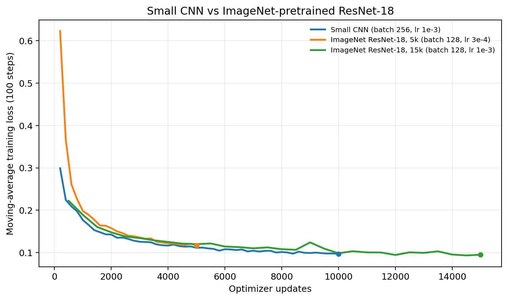

# Project 5：VLA Action Diffusion 实验报告

本项目在二维环境中实现并评估视觉条件动作策略，比较行为克隆（BC）、去噪扩散（DDPM）与 Flow Matching（FM），并研究动作块长度、填充掩码、视觉编码器和环境变化。

## 一、实验内容

`Reach2DEnv` 将场景渲染为 64×64 RGB 图像，包含智能体、目标和两个障碍物。视觉策略接收图像与智能体位置，no vision (state-only) 则接收智能体和目标坐标，作为一个参照条件。

策略预测长度为 `H` 的二维动作块，每执行前 4 步后重新观测和规划。动作先裁剪到 `[-1, 1]²`，环境再乘以 `ACTION_SCALE=0.05` 更新位置；目标距离小于 `0.06` 判成功，智能体与障碍物距离小于 `0.10` 判碰撞，每回合最多 100 步。

视觉编码器为三层 stride-2 CNN（3→32→64→128），每层使用 GroupNorm 与 SiLU，最后4×4 自适应池化保留空间信息，再映射为 128 维特征。状态、图像和时间嵌入共同条件化动作生成器，动作块展平后由隐藏宽度为 256 的 MLP 预测噪声、速度或动作。

DDPM 使用余弦噪声调度；BC 直接回归动作块，FM 回归速度场。

### 二、Loss 设计

令 $o$ 表示当前图像与允许输入的状态，$`\mathbf{a}_0=(a_0,\ldots,a_{H-1})`$ 表示一段动作块。DDPM 对动作块加噪并预测噪声：

$$
\begin{aligned}
\mathbf{a}_t &= \sqrt{\bar\alpha_t}\,\mathbf{a}_0+\sqrt{1-\bar\alpha_t}\,\boldsymbol\epsilon, \\
\mathcal{L}_{\mathrm{DDPM}} &= \mathbb{E}_{t,\mathbf{a}_0,\boldsymbol\epsilon,o} \\
&\quad \left[\left\|\boldsymbol\epsilon-\boldsymbol\epsilon_\theta(\mathbf{a}_t,t,o)\right\|_2^2\right].
\end{aligned}
$$

BC 直接回归动作块，FM 在高斯噪声与数据动作之间线性插值，并学习从噪声指向动作的速度场。开启 padding mask 时，三种损失均只对有效动作槽位计入均方误差。

$$
\begin{aligned}
\mathcal{L}_{\mathrm{BC}} &= \mathbb{E}\left[\|f_\theta(o)-\mathbf{a}_0\|_2^2\right], \\
\mathbf{a}_t &= (1-t)\mathbf{z}+t\mathbf{a}_0, \\
\mathcal{L}_{\mathrm{FM}} &= \mathbb{E}\left[\|v_\theta(\mathbf{a}_t,t,o)-(\mathbf{a}_0-\mathbf{z})\|_2^2\right].
\end{aligned}
$$

## 三、实验结果

公平对照中的 BC、视觉 DDPM、视觉 FM 和 chunk 条件均使用训练 seed 42、同一批 1,000 条成功专家轨迹（按各自 H 构造动作块）、4×4 spatial CNN、余弦噪声调度、10,000 次更新和相同的 100 个评估 episode（环境 seeds 10000–10099）。batch size 为 256，优化器为 AdamW，learning rate 为 1e-3，weight decay 为 0，EMA decay 为 0.999；每执行 4 步后重新规划。DDPM 使用 20 步 DDIM，FM 使用 10 步 Euler。公平矩阵 checkpoint 于 2026-10-13 从 Project 5 fair seed 42 Release 恢复，并用代码提交 `c062751` 重评估，没有重新训练。state-only DDPM 是不同输入条件下的参照结果，不属于视觉公平矩阵。

以下按任务要求的五条主线组织主要结果。

| 实验主线 | 代表配置 | 主要结果 | 核心观察 |
|---|---|---|---|
| Pure BC (no diffusion) | H=16，图像 + agent state，MSE | 成功 88%，碰撞 9%，超时 3%；平均 26.95 步，末端距离 0.0913 | BC 点估计高于视觉 DDPM，接近 FM |
| DDPM (no vision) | H=16，agent + target 坐标，DDIM 20 步 | 成功 81%，碰撞 12%，超时 7%；平均 55.89 步，末端距离 0.1075 | state-only 直接获得目标坐标，输入信息与视觉策略不同 |
| DDPM + vision | H=16，图像 + agent state，4×4 spatial，masked | 成功 81%，碰撞 8%，超时 11%；平均 35.57 步，末端距离 0.1339 | 达到项目 70% 参考目标；仅一个训练 seed |
| FM + vision | H=16，图像 + agent state，Euler 10 步 | 成功 87%，碰撞 7%，超时 6%；平均 29.53 步，末端距离 0.0987 | 与 BC 接近；较少 NFE 不等同于实测加速 |
| Chunk 8 vs 32 vs 64 | 视觉 DDPM；masked H=8/32/64 成功率 89%/48%/26%；unmasked 91%/66%/28% | masked 超时率 4%/46%/73%；unmasked 2%/27%/63% | H=8 点估计最高；长 chunk 的超时率较高 |

以上公平条件每个只有一个训练 seed；成功率是 100 个固定评估 episode 的观测比例，不能说明训练 seed 间方差或方法差异显著。

### 1）Pure BC (no diffusion)

Pure BC 直接以图像和 agent 位置回归 H=16 动作块，不经过生成式采样。成功率为 88%，碰撞率 9%、超时率 3%；平均 26.95 步完成，末端距离为 0.0913。与同一公平协议下的视觉 DDPM（81%）和 FM（87%）相比，BC 没有落后；在当前二维任务和专家数据规模下，生成式动作建模并未自动带来更高的成功率。

### 2）DDPM (no vision)

state-only DDPM 的 H=16 参照实验使用 agent 与 target 显式坐标、20 步 DDIM，成功率为 81%。下表将它与公平矩阵中的视觉 DDPM 并列；两者成功率点估计相同，但观测条件并不相同。

| 条件 | 输入条件 | 成功率 | 碰撞率 | 超时率 | 平均步数 | 末端距离 |
|---|---|---:|---:|---:|---:|---:|
| DDPM (no vision) | agent + target 坐标 | 81% | 12% | 7% | 55.89 | 0.1075 |
| DDPM + vision | RGB 图像 + agent 坐标 | 81% | 8% | 11% | 35.57 | 0.1339 |

state-only 直接获得目标位置，却没有障碍物坐标；视觉策略则从图像识别目标与障碍。两种输入的信息量和难度不同，因此这个结果只能作为条件接口参照，不能解释为视觉单因素带来的效果变化。

### 3）DDPM + vision

视觉 DDPM 接收 64×64 RGB 图像和 agent 坐标，使用 4×4 空间池化 CNN、H=16 masked action chunk 与 20 步 DDIM。公平复评成功率为 81%，碰撞率 8%、超时率 11%；达到项目提出的 70% 参考目标。由于只有一个训练 seed，这一结果是当前评估集上的点估计。

以下闭环图展示四条成功轨迹，作为定性示例，与 100 episode 汇总指标互补。

<table>
  <tr>
    <td align="center"><br/><sub>Episode 0</sub></td>
    <td align="center"><br/><sub>Episode 1</sub></td>
  </tr>
  <tr>
    <td align="center"><br/><sub>Episode 2</sub></td>
    <td align="center"><br/><sub>Episode 3</sub></td>
  </tr>
</table>

### 4）FM + vision

FM 在相同视觉条件、H=16 和公平评估 episode 下达到 87% 成功率，碰撞率 7%、超时率 6%；采样使用 10 步 Euler。BC 为 88%，视觉 DDPM 为 81%。这些单种子点估计显示 FM 与 BC 接近，但不能据此判断差异稳定或显著；采样步数较少也不等于实测端到端加速。FM 替代 DDPM 的具体实现和并列数据见扩展实验第一项。

### 5）Chunk 8 vs 32 vs 64

下表列出同一视觉 DDPM 公平矩阵中 masked 与 unmasked 的结果；H=16 作为中间参照。所有条件采用相同的训练和评估 episode。

| H | padding mask | 成功率 | 碰撞率 | 超时率 | 平均步数 | 末端距离 | 沿途目标距离 |
|---:|:---:|---:|---:|---:|---:|---:|---:|
| 8 | 是 | 89% | 7% | 4% | 27.57 | 0.0994 | 0.4852 |
| 8 | 否 | **91%** | 7% | 2% | 26.37 | 0.0919 | 0.4887 |
| 16 | 是 | 81% | 8% | 11% | 35.57 | 0.1339 | 0.4675 |
| 16 | 否 | 85% | 8% | 7% | 31.50 | 0.1115 | 0.4769 |
| 32 | 是 | 48% | 6% | 46% | 64.39 | 0.2621 | 0.4612 |
| 32 | 否 | 66% | 7% | 27% | 54.73 | 0.2138 | 0.4716 |
| 64 | 是 | 26% | 1% | 73% | 85.86 | 0.3668 | 0.5033 |
| 64 | 否 | 28% | 9% | 63% | 81.96 | 0.4147 | 0.5955 |

H=8 的观测成功率最高。H 增至 32、64 后，masked 成功率降至 48%、26%，超时率升至 46%、73%，说明长动作块在当前重规划设置下更难稳定完成任务。masked 与 unmasked 的差异不能证明 mask 有害：每种条件只有一个训练 seed，mask 的损失归一化与尾部动作语义仍可进一步验证。

## 四、扩展实验

本节按四项加分要求分别报告实现、评估和主要结论。总览图汇总扩展实验的闭环结果，并标示多目标评测中的目标位置与分模式成功率。


### 1）Flow Matching 替代 DDPM（+10）

FM 将 DDPM 的噪声预测目标替换为速度场回归，并用 Euler ODE 从噪声生成动作块。下表中的 BC、DDPM 与 FM 使用同一视觉条件、H=16、专家数据及固定评估集；各方法按照自身生成机制推理。

| 方法 | 训练目标 | 推理方式 | 成功率 | 碰撞率 | 超时率 | 平均步数 |
|---|---|---|---:|---:|---:|---:|
| Pure BC | 动作块 MSE | 直接回归 | 88% | 9% | 3% | 26.95 |
| DDPM + vision | 噪声预测 | DDIM，20 步 | 81% | 8% | 11% | 35.57 |
| FM + vision | 速度场回归 | Euler，10 步 | 87% | 7% | 6% | 29.53 |

FM 已完成对 DDPM 训练目标的替换，成功率点估计与 BC 接近。10 步对 20 步只表示采样调用配置较少，本实验没有测量端到端推理延迟，不能声称实测加速倍数。

### 2）Multi-modal demo 数据集：多个 target（+10）

训练 demo 覆盖两个 target 坐标：$(-0.65, 0.55)$ 与 $(0.65, 0.55)$。H=16 视觉 DDPM 在 100 个 episode 上总体成功 97 次；按目标模式统计如下。

| 目标模式 | 目标坐标 | Episode 数 | 成功数 | 成功率 |
|---|---:|---:|---:|---:|
| Mode 0 | $(-0.65, 0.55)$ | 52 | 50 | 96.2% |
| Mode 1 | $(0.65, 0.55)$ | 48 | 47 | 97.9% |
| 合计 | 两种目标 | 100 | 97 | 97.0% |

总体碰撞率为 3%，超时率为 0%。下面分别展示两个目标条件下的成功闭环轨迹。由于目标位置在图像中可见，这说明模型能处理两个目标条件，但尚不能证明同一观测下生成双峰动作分布。

<table>
  <tr>
    <td align="center"><br/><sub>Mode 0：左侧目标</sub></td>
    <td align="center"><br/><sub>Mode 1：右侧目标</sub></td>
  </tr>
</table>

### 3）ImageNet-pretrained ResNet-18 替换小 CNN（+5）

ResNet-18 加载 ImageNet 预训练权重（`vision_pretrained: true`），参数量 11.48M；小 CNN 参数量 0.59M。AutoDL 日志中的更新速度与末段 100-step 平均 loss 如下。

| Backbone | 更新步数 | Batch / learning rate | 吞吐 | 末段 avg100 loss |
|---|---:|---:|---:|---:|
| Small CNN | 10,000 | 256 / $1\times10^{-3}$ | 65.9 step/s | 0.0968 |
| ImageNet ResNet-18 | 5,000 | 128 / $3\times10^{-4}$ | 63.8 step/s | 0.1168 |
| ImageNet ResNet-18（延长训练） | 15,000 | 128 / $1\times10^{-3}$ | 67.0 step/s | 0.0950 |



同样更新至 5,000 步时，小 CNN 的 avg100 loss 为 0.1113，ResNet-18 为 0.1168；ResNet-18 延长至 15,000 步后降到 0.0950，接近小 CNN 10,000 步时的 0.0968。它约多用 50% 更新步数才到达相近训练 loss，而单步吞吐相近。batch size、部分学习率和训练 seed 不同，因此这是描述性比较，不是严格控制变量结论。闭环评估中 ResNet-18 5k/15k 成功率分别为 3%/2%，低于当前小 CNN 公平矩阵的 81% 参考值；评估 seeds 和配置不同，这一差异也不作严格排名。

### 4）移动障碍环境泛化（+10）

复用静态障碍训练得到的同一个 H=16 视觉 DDPM checkpoint，不在移动障碍环境重新训练；测试时障碍速度设为 0.025。两种环境评测各 100 个 episode，使用相同模型，seed 区间不同。

| 测试环境 | 评估 seeds | 成功率 | 碰撞率 | 超时率 | 平均步数 | 末端距离 |
|---|---|---:|---:|---:|---:|---:|
| 静态障碍 | 10000–10099 | 71% | 3% | 26% | 48.70 | 0.1643 |
| 移动障碍（速度 0.025） | 40000–40099 | 72% | 20% | 8% | 34.94 | 0.1867 |

成功率点估计相近，但碰撞率由 3% 升至 20%，说明策略具备一定迁移能力，安全鲁棒性仍不足。动态环境中平均步数较低主要伴随更多碰撞，不能解释为路径效率改善。下方为移动障碍测试中的两条成功轨迹。

<table>
  <tr>
    <td align="center"><br/><sub>Episode 0</sub></td>
    <td align="center"><br/><sub>Episode 5</sub></td>
  </tr>
</table>

## 对照原始任务要求的自查与反思

### 自查问题

1. **为什么预测动作块？** 一次预测 $H$ 步能减少每个环境步都重新调用生成模型的开销，并让局部动作保持连贯；每执行 `exec_steps` 步再观察和规划，则保留闭环纠偏能力。若 `exec_steps=1`，反馈更及时，但会增加采样调用与推理开销。本项目固定每 4 步重规划，在闭环纠偏和调用成本之间折中。
2. **多模态下 MSE BC 会怎样？** 若同一观测有绕障碍物左、右两条合理轨迹，MSE 往往趋向两种动作的条件均值；均值轨迹可能穿过障碍，或落在数据里没有出现过的中间模式。扩散策略可通过不同噪声样本表达多个动作分布模式。但本项目的双目标实验是目标位置不同、图像条件也不同，证明了两种目标条件都可完成，**没有证明同一观测下生成左右两种绕行轨迹**。
3. **state-only 与视觉策略的结果能否直接比较？** 两者在当前记录中的成功率点估计均为 81%，但 state-only 直接输入目标坐标，视觉策略则从图像识别目标和障碍；碰撞率、超时率和平均步数也不同。因此它们是不同观测条件下的参照，不是信息量匹配的单因素视觉消融。若把障碍坐标也放入 state，就会成为带特权几何信息的基线。
4. **padding 如何影响策略？** 专家轨迹短于 H 时重复末动作会形成非有效尾部监督；H 越大，重复槽位越多，动作块中真实运动信息占比越小，可能使预测变迟缓并增加超时。本实验记录了有效槽位掩码并对 masked/unmasked 做了公平比较；单训练 seed 下 masked 点估计反而略低，故不能宣称掩码必然提升成功率。下一步应检查 mask 的损失归一化、尾部动作语义，并增加训练 seeds。
5. **FM 相对 DDPM 对实时控制的潜在收益是什么？** FM 用 ODE 速度场从噪声积分到动作，当前配置用 10 步 Euler；DDPM 使用 20 步 DDIM，因此前者理论上需要更少的模型函数调用。公平矩阵中 FM 成功率 87%、DDPM 81%，但区间重叠且只有一个训练 seed；本项目没有测端到端延迟，不能据此声称 FM 快 5 倍或显著优于 DDPM。

### Reflection（约 300 字）

这个二维实验没有真实相机标定、机械臂动力学、执行器延迟和接触过程。Pi-0 或 OpenVLA 部署到工业机器人前，还需要处理相机内外参漂移、光照变化、遮挡、反光及多传感器时间同步，并验证语言指令与视觉目标是否一致。动作从归一化平面坐标变成关节或末端控制量后，必须满足速度、力矩、工作空间和碰撞约束；网络输出也要经过安全过滤、限幅、异常检测和可验证的急停/回退控制。真实任务还需要覆盖稀有故障和分布外场景的数据，进行域适配、跨设备复现、长时间稳定性与延迟测试，并保留操作员接管、审计日志和版本回滚机制。因而高离线成功率只是进入真实部署评估的起点，不是安全或可靠性的证明。

### 原始要求与仓库证据

| 原始要求 | 当前实现 / 证据 | 结论与边界 |
|---|---|---|
| TODO 19：action-chunk DDPM loss | `train.py`；余弦 scheduler、DDPM 目标及 mask loss；`tests/test_project5.py` | 已实现 |
| TODO 20：视觉编码与 observation conditioning | `model.py`；CNN + 4×4 spatial pooling；图像和 agent state 条件 | 已实现；全局池化负结果保留作对照 |
| TODO 21：闭环评估 | `eval.py`；成功、碰撞、超时、步数、末端距离和轨迹目标距离 | 已实现；每个公平条件 100 episodes |
| test 环境成功率 ≥70% | 公平视觉 DDPM H=16 masked：81%；移动障碍评估：72% | 达到点估计目标；移动障碍碰撞率 20%，安全性仍有限 |
| 消融、训练曲线与条件分析 | 本 README 的五类主结果、四项扩展和收敛曲线；`results/ablation.md`、`results/fair_seed42/` | 已报告；主结论以当前公平复评为准 |
| ≥3 个成功 rollout、实验日志、≥3 条真实 debug 记录 | `results/rollouts/`（本文以 2×2 图组嵌入 4 张）；`logs/exp_log.md`；`debug_log.md`（5 条） | 文件齐全 |
| FM 加分项 | 公平矩阵 H=16 masked：FM 87%，10-step Euler；DDPM 81%，20-step DDIM | 已实现并比较；未测实际 wall-clock 加速倍数 |
| 多目标 / multimodal demos | 双目标数据，两个目标条件成功率 96.2% / 97.9% | 部分满足：未证明同一观测下的双峰动作分布，不夸称完整通过 +10 |
| ResNet-18 与移动障碍加分项 | ResNet-18 5k/15k 训练和闭环结果；静态策略在移动障碍上评估 | 已做扩展实验；ResNet 收敛速度非严格同预算比较，动态场景碰撞仍高 |

## 复现

评估同时报告末端距离（FDE）与整段轨迹的目标距离：`mean_path_target_distance` 先对单条 rollout 的所有已访问位置（包括初始位置）计算到目标的欧氏距离均值，再跨 episode 求均值。它反映整个过程的目标接近程度，不是相对专家轨迹的 ADE；因此不能解释为轨迹模仿误差。碰撞与到达若在同一步同时发生，按碰撞失败计数。

实验日志记录的软件环境为 Python 3.12.3、PyTorch 2.8.0+cu128。请先按本机平台安装匹配的 PyTorch 与 torchvision，再在项目目录安装其余依赖并运行自检：

```bash
python -m pip install pyyaml tqdm matplotlib numpy
python check_setup.py
```

先运行短 smoke 对照，再运行完整公平矩阵：

```bash
python run_fair_experiments.py --preset algorithms --seed 42 --episodes 5 --steps 20 --run-root runs/fair_smoke
python run_fair_experiments.py --preset full --seed 42 --episodes 100 --steps 10000 --run-root runs/project5_fair
```

已有 checkpoint 或结果时，可在完整命令末尾加 `--resume` 跳过已完成项。缺少公平实验 demo 文件时，脚本会调用训练入口采集数据。扩展实验与汇总图：

```bash
python run_bonus_experiments.py --preset all
python plot_bonus.py
```

移动障碍 preset 使用仓库中的静态训练 checkpoint `ckpts/model_final.pt`，不在动态环境重新训练；公平矩阵运行时 checkpoint 写入 `runs/`，已提交结果摘要位于 `results/fair_seed42/`。可选的 `monitor_dashboard.py` 用于查看运行状态；`launch_after_gpu_idle.sh` 面向 AutoDL，会等待 Project 4 相关进程结束及 GPU 空闲。

## 文件索引

- `env.py`、`dataset.py`、`obs_utils.py`：环境、专家数据与观测条件处理。
- `model.py`、`train.py`、`eval.py`：策略结构、训练与闭环评估；`configs/`：实验配置。
- [公平矩阵汇总](results/fair_seed42/fair_ablation.md)；[公平矩阵指标](results/fair_seed42/fair_summary.json)；`results/ablation.md`：历史消融指标归档，不纳入正文主结果；[实验日志](logs/exp_log.md)。
- [state-only 评估](results/eval_state.json)、[视觉评估](results/eval_vision.json)：条件参照；`results/rollouts/`、`results/bonus_rollouts/`：示例轨迹；`results/*.json`：扩展实验指标。
- `logs/train_spatial.log`、`logs/train_resnet18*.log`：ResNet 收敛图的数据来源；`results/metrics/`：训练指标；[公平实验方案](FAIR_EXPERIMENT_PLAN.md)：对照协议；[调试记录](debug_log.md)：5 条实际实现/运行问题。
- [实验日志模板](experiment_log_template.md)是通用模板，其中示例数据不是本项目结果。

## 从 GitHub Release 恢复并重评估

训练好的公平矩阵 checkpoint 与原始结果作为 GitHub Release 附件提供，避免把大型二进制文件塞进 Git 历史。克隆本仓库 `main` 后，在项目目录执行以下命令即可从 Release 恢复模型，并用当前版本评估代码重新跑 100 个固定 episode；新结果写到独立目录，不会覆盖发布时的原始结果：

```bash
mkdir -p assets/release assets/restored
cd assets/release
base=https://github.com/li-cheng111/my-diffusion-models-starter/releases/download/project5-fair-seed42-v1.0.0
curl -fLO "$base/SHA256SUMS"
curl -fLO "$base/project5-fair-seed42-checkpoints.tar.gz"
curl -fLO "$base/project5-fair-seed42-results.tar.gz"
curl -fLO "$base/project5-vla-action-diffusion-source-14a93fd.tar.gz"
sha256sum -c SHA256SUMS
curl -fLO "$base/project5-fair-seed42-reeval-c062751.tar.gz"
curl -fLO "$base/project5-vla-action-diffusion-source-a2b695d.tar.gz"
curl -fLO "$base/SHA256SUMS-project5-c062751.txt"
sha256sum -c SHA256SUMS-project5-c062751.txt
cd ../..
tar -xzf assets/release/project5-fair-seed42-checkpoints.tar.gz -C assets/restored
mkdir -p runs/project5_release_eval_archive
tar -xzf assets/release/project5-fair-seed42-reeval-c062751.tar.gz -C runs/project5_release_eval_archive
python eval_checkpoint_archive.py --checkpoint-root assets/restored/runs/project5_fair --run-root runs/project5_release_eval --episodes 100 --seed-start 10000
```

`eval_checkpoint_archive.py --resume` 会跳过已经生成 `eval.json` 的条件，适合断线后接续；正式复现训练矩阵则使用上一节的 `run_fair_experiments.py` 命令。Release 中原 `SHA256SUMS` 校验 checkpoint、首批结果和源码快照；`SHA256SUMS-project5-c062751.txt` 校验本次复评结果和更新后的源码快照。复评归档可直接检查或引用；从 checkpoint 重新运行脚本则会生成新的完整评估目录。Release source 是源码快照；实验应以当前克隆的 `main` 作为评估代码。

## 限制

这是无摩擦、无动力学的二维点质量环境，不代表真实机器人控制能力。公平矩阵只有一个训练 seed，因此成功率是单次评估集上的观测比例，不能反映训练 seed 间方差。移动障碍实验的碰撞率升至 20%，静态训练策略在环境变化下仍有安全局限。多目标实验尚未验证同一观测下的双峰动作轨迹；ResNet-18 实验也没有按统一 wall-clock 或统一收敛阈值比较速度。因此，这两项结论按已获得的证据限定，不把部分验证写成完整证明。
